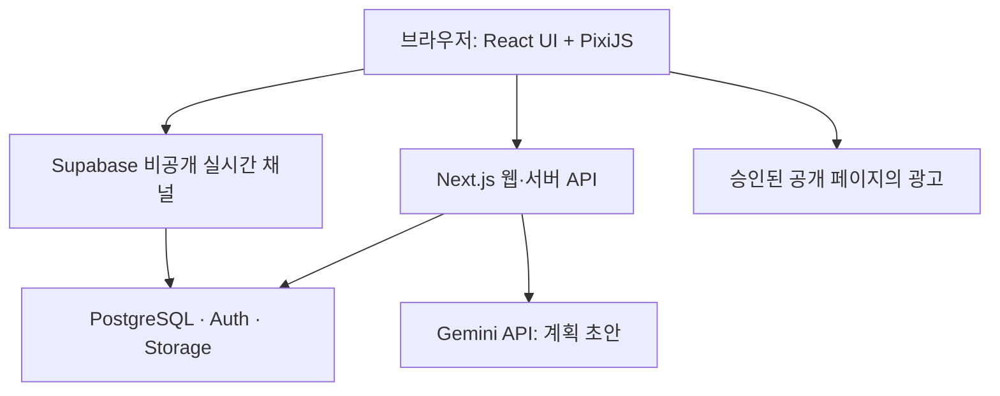

# SideTown 웹앱 세부 기획서

> 가칭: 사이드타운(SideTown) · 버전: 1.2 · 작성일: 2026-10-26 · 개정: 2026-10-27
> 용도: 제품 기획, Higgsfield 디자인 제작, 개발 착수, 비공개 베타 및 공개 출시의 공통 기준
> 문서 상태: 대화에서 확정한 요구사항을 바탕으로 작성한 구현 제안서. 기술 선택·수치·보상·일정은 아래의 제안값으로 시작하고 사용 결과에 따라 조정한다.
> 진행 상황: Higgsfield로 콘셉트 이미지(마을 B안 밤·비·눈, 건물 3종, 공방 성장·낡음·수리, 캐릭터)를 제작했고 디자인 캔버스 ‘SideTown UI 초안’에 화면 시안을 정리했다. 서비스 배포·유료 서비스 가입·광고 신청은 아직 수행하지 않았다.

## 0. 변경 요약

### v1.2 (2026-10-27)

| 영역 | v1.1 | v1.2 | 관련 절 |
| --- | --- | --- | --- |
| 친구 소통 | 이모지 응원만, 메시지 제외 | 친구에게 쪽지, 카페의 마을 게시판, 프로젝트에 남기는 응원 한마디. 실시간 채팅은 여전히 제외 | 13.5 |
| 공용 공간·집 | 단계 0 빌드에서 ‘나중에 열림’ 안내 | 처음부터 열림. 카페=게시판·지금 마을·공용 해금, 집=캐릭터·숙련도·진열장 | 5, 6.8 |
| 새 프로젝트 | 단계 1에서 연결 예정 | 빈 부지·‘+ 새 프로젝트’ 버튼에서 바로 착공(템플릿 초안, AI 초안은 단계 1) | 6.8 |
| 건물 성장 | 같은 크기 안에서 살림만 늘어남 | 공사 부지 → 방 한 칸 → 2층 → 시계탑·돔 랜드마크로 외곽선부터 다르게. 성장 순간 빛기둥·불꽃 연출 | 11 |
| 집중 모드 풍경 | 정지 이미지 | 10초 반복 영상(사람 산책·커피·고양이·새·물결·바람) + 실시간 날씨 층(바람 세기 변화·돌풍·비·눈·낙엽·새 떼·반딧불) | 6.6 |
| 마을 화면 | 친구 캐릭터 고정 | 접속 중인 친구가 광장·카페를 천천히 돌아다님, 눌러서 쪽지 | 7.4 |

### v1.1 (2026-10-26)

| 영역 | v1.0 | v1.1 | 관련 절 |
| --- | --- | --- | --- |
| 일정·목표 관리 | 퀘스트 목록과 AI 계획 중심 | 주간 캘린더(타임블로킹), 프로젝트 타임라인·표·보드, 퀘스트 속성, 오늘 계획하기, 주간 회고 추가 | 2, 5, 6.5, 8.1~8.3, 16, 18 |
| 일정 미루기 | 개별 수정만 가능 | 연쇄 미루기(뒤 일정 전체), 목표일 고정 압축, 기준선과 누적 지연 기록 | 8.2 |
| 지연 표현 | 미접속 시 붕괴 없음(원칙 5) | 처음 목표 대비 누적 지연 30일 이상이면 건물이 일시적으로 낡음 → 작업 재개 시 수리·복구. 경험치·기록은 유지 | 3, 8.3, 11 |
| 진척도 표현 | 막대·분절 바 | 항해 진척도(배=실제, 부표=계획 위치, 깃발=목표일, 물결=상태) | 6.7 |
| 집중 모드 | 작업 세션 시작·종료 | 전체 화면 마을 + 뽀모도로 + 장면(밤·비·눈) + 실시간 합성 BGM·환경음 믹서 | 6.6, 19 |
| 디자인 방향 | 크림 배경·청록 강조, A안 낮 | B안(해 질 녘·밤) 기반 다크 UI, 앰버·코랄 강조, IBM Plex Sans KR | 12 |
| 외부 캘린더 | 후속 버전 | Google 캘린더 **읽기 전용** 연동을 첫 버전 후보로 상향(확정 필요) | 14, 28 |

## 1. 서비스 정의와 최종 목표

**친구와 함께 사는 복셀 크리에이터 동네에서, 현실의 프로젝트를 완성하며 캐릭터와 작업 공간을 성장시키는 웹앱.**

출판, 앱 개발, 자격증, 창작처럼 오래 걸리는 목표를 실행 가능한 퀘스트로 나눈다. 사용자는 마을의 건물을 선택해 프로젝트에 접근하고, 실제 작업을 완료하면서 캐릭터와 건물을 성장시킨다.

### 해결할 문제

1. 꾸준히 해도 성과가 보이지 않아 흥미가 떨어진다.
2. 여러 프로젝트를 시작하지만 다시 시작할 지점과 마무리 기준이 불명확하다.
3. 계획·기록 자체가 새로운 일이 되어 실행을 방해한다.

### 첫 출시의 완료 조건

- 누구나 공개 웹 주소에서 가입할 수 있다.
- 가입자는 혼자 마을을 시작하거나 초대받은 마을에 참여할 수 있다.
- 프로젝트 생성 → AI 계획 확인·수정 → 작업 → 완료·성과 기록 → 성장의 전체 흐름이 작동한다.
- 퀘스트를 캘린더에 배치하고, 미루면 뒤 일정이 함께 이동하며, 주간 회고로 다음 주 계획을 세울 수 있다.
- 집중 모드에서 뽀모도로와 배경 소리를 켜고 작업 시간이 퀘스트 기록에 쌓인다.
- 최대 8명이 개인·공동 프로젝트를 이용하고 접속·집중 상태와 이모지 응원을 공유한다.
- 정책과 심사 조건에 맞는 화면에서 실제 배너 광고가 송출된다.
- 광고 사업자의 보고서에서 실제 수익이 발생한 것을 운영자가 확인한다.

광고 심사·수익 발생은 외부 의존성이 있으므로 `제품 공개 완료`와 `수익화 완료`를 별도 상태로 관리한다. 첫 예상 수익 확인과 지급 확정·실제 입금은 다른 단계다. 월 운영비 충당은 출시 이후의 다음 목표로 둔다.

## 2. 확정 요구사항과 구현 제안

| 항목 | 대화에서 확정한 방향 | 이 문서의 구현 제안 |
| --- | --- | --- |
| 사용자 | 본인과 지인이 먼저 사용, 이후 공개 가입 | 초기 한국어 서비스, 초대형 비공개 마을 |
| 마을 | 친구·지인 2~8명이 같은 마을 이용 | 혼자 생성 가능, 기본 1인 1개 소속 마을 |
| 미감 | 복셀 크리에이터 동네 | 고정 아이소메트릭 시점의 2.5D 렌더링 |
| 프로젝트 | 건물마다 개인 또는 공동 프로젝트 | 프로젝트 1개당 건물 1개 |
| 탐색 | 건물·바닥 클릭/터치로 자동 이동 | 그리드 경로 탐색, 이동 중 패널 조작 가능 |
| 화면 | 큰 마을 + 건물 확대 + 옆 패널 | PC 패널 폭 360~420px, 모바일 하단 시트 |
| 계획 | AI 제안 후 사용자가 수정 | 전체 단계와 가까운 1주 퀘스트 생성 |
| 기록 | 작은 퀘스트는 체크, 중간 목표는 기록 | 메모·링크·이미지 중 하나 이상 |
| 보상 | 레벨·장비·직업, 건물·마을 성장 | 경험치와 성과 기반 해금, 현금성 재화 없음 |
| 소통 | 접속·작업 건물 확인, 이모지 응원 | 실시간 위치·채팅·음성 제외 |
| 꾸미기 | 정해진 부지, 품질 좋은 구조·색상·간판·소품 | 검수된 모듈과 팔레트만 제공 |
| 기기 | PC 중심, 모바일은 확인·체크 | 마을이 실패해도 목록에서 핵심 기능 사용 |
| 디자인 제작 | Higgsfield 연결 활용 | 제작 단계에서 시안·에셋 생성, 런타임 호출 제외 |
| 수익 | 배너 광고 수익 발생까지 | AdSense 우선, 공개 콘텐츠 중심의 광고 허용 목록 |
| 일정 관리 | 일정·목표 관리가 가장 중요, Notion 등 벤치마킹 | 같은 데이터를 마을·캘린더·타임라인·표·보드로 보기, 보관함 → 캘린더 타임블로킹 |
| 미루기 | 미룰 때 전체 일정을 같이 미룰 수 있어야 함 | 이 퀘스트만 / 뒤 일정 전체 / 목표일 고정 압축 3가지, 미리보기 후 저장 |
| 지연 연출 | 한 달 이상 밀리면 건물이 다시 수행할 때까지 망가짐 | 누적 지연 30일 이상 → 낡음, 작업 시작 → 수리 중, 퀘스트 1개 완료 → 복구·기준선 재설정 |
| 진척도 | 목표·회고에 차별화된 작은 요소 | 물결 위 배가 진척도만큼 나아가는 ‘항해 진척도’ 컴포넌트 |
| 집중 모드 | 마을 전체 화면 + 배경/BGM + 뽀모도로 | 25/5/15분 타이머, 장면 3종, BGM 3곡·환경음 4종 믹서, UI 숨기기 |
| 테마 | 더 어두운 색, 기본 AI 도구 느낌 탈피 | 밤 남색 바탕 + 앰버/코랄, 픽셀·모노 서체를 숫자·레벨에만 사용 |

## 3. 제품 원칙

1. **실행이 먼저다.** 첫 퀘스트까지 긴 캐릭터 설정이나 꾸미기를 요구하지 않는다.
2. **성장은 눈에 보인다.** 작은 노력은 캐릭터, 실제 성과는 건물과 앨범에 남긴다.
3. **마을은 내비게이션이다.** 예쁜 배경 이미지 한 장 위에 버튼만 얹는 구성으로 끝내지 않는다.
4. **게임을 몰라도 사용한다.** 퀘스트에는 ‘할 일’, 경험치에는 설명을 붙이고 목록 접근을 제공한다.
5. **쉬었다 돌아와도 이어진다. 지연은 벌이 아니라 신호다.** 미접속만으로 건물을 망가뜨리지 않고, 경험치·기록·성장 단계를 깎거나 친구에게 피해를 주지 않는다. 계획이 처음 목표보다 30일 넘게 밀린 프로젝트만 건물 외관이 일시적으로 낡으며(8.3), 작업을 재개하면 바로 수리가 시작된다. 의도적으로 멈춘 ‘항해 쉬기’ 프로젝트는 낡지 않고, 사용자는 이 연출을 끌 수 있다.
6. **꾸미기 품질을 우선한다.** 어울리지 않는 모듈은 제공하지 않고 완성된 기본 외관을 유지한다.
7. **공개 가입과 기록 공개는 다르다.** 마을과 개인 작업 내용은 인터넷 전체에 공개되지 않는다.
8. **계획은 다시 짜도 괜찮다.** 미루기는 숨기지 않고 한 번에 처리한다. 뒤 일정까지 함께 옮기고, 처음 계획(기준선)과의 차이를 보여주되 비난하는 문구를 쓰지 않는다.
9. **하나의 데이터, 여러 보기.** 마을 건물·프로젝트 패널·캘린더·타임라인·표·보드는 같은 프로젝트·중간 목표·퀘스트를 다르게 보여줄 뿐이다. 어느 화면에서 바꿔도 모든 화면에 같은 결과가 반영된다.

## 4. 핵심 사용자 시나리오

### 4.1 최초 시작

1. 공개 소개 화면에서 서비스 예시와 실제 사용 흐름을 확인한다.
2. Google 계정으로 로그인한다. 초대 링크가 있다면 로그인 후 초대 화면으로 돌아온다.
3. 닉네임과 기본 캐릭터를 정한다. 외형 세부 설정은 건너뛸 수 있다.
4. 새 마을을 만들거나 초대를 수락한다. 정원이 찼다면 다른 마을 생성 선택지를 제공한다.
5. 목표, 현재 상태, 가능한 시간, 완료 기준, 선택적 목표일을 입력한다. 처음 한 번 요일별 가용 시간(예: 평일 19–23시 중 2시간, 주말 6시간)을 정한다. 기본값으로 건너뛸 수 있다.
6. AI 초안을 검토·수정하고 확정한다. AI 실패 시 수동 작성 또는 기본 예시로 계속한다.
7. 건물 유형과 빈 부지를 선택한다. 기본 외관으로 즉시 시작할 수 있다.
8. 첫 퀘스트가 열린다. 친구 초대와 꾸미기는 이후 진행한다.

### 4.2 일상 사용

마을 입장 → 건물 선택 → 다음 퀘스트 확인 → 작업 시작 → 실제 작업 → 체크 또는 성과 기록 → 보상 확인.

접속하면 마지막으로 선택한 프로젝트와 마지막 메모를 복원한다. 자동으로 작업 중 상태를 시작하지 않는다.

**하루 흐름(선택):** 오늘 계획하기 → 어제 못 끝낸 일을 ‘오늘 / 다른 날 / 보관’으로 정리 → 보관함에서 오늘 빈 시간에 퀘스트 배치 → 집중 모드로 작업 → 완료 체크.

**주간 흐름(선택):** 일요일 저녁(설정 가능) 주간 회고 알림 → 완료·집중 시간·계획 대비 실적 확인 → AI 재계획 제안 선택 → 밀린 일 정리 → 다음 주 계획. 15분 안에 끝나도록 설계한다.

### 4.2.1 일정이 밀릴 때

1. 캘린더 블록을 다른 날로 끌거나, 퀘스트 상세의 ‘일정 바꾸기’를 누른다.
2. 미루기 창에서 기간(하루·3일·1주·2주·날짜)과 범위(이 퀘스트만 / 뒤 일정 전체 / 목표일 고정 압축)를 고른다.
3. 미리보기에서 기준선 대비 바뀐 일정, 새 도착일, 충돌·과부하, 누적 지연(○일 / 30일)을 확인하고 저장한다.
4. 누적 지연이 30일을 넘으면 건물이 낡는다는 안내를 저장 전에 보여준다. 넘은 뒤에는 ‘15분짜리 퀘스트로 불 켜기’처럼 가장 작은 다음 행동을 제안한다.

### 4.3 공동 프로젝트

프로젝트 소유자가 현재 마을의 구성원을 초대한다. 퀘스트마다 담당자 1명을 정하고 필요하면 하위 퀘스트로 나눈다. 담당자는 자신의 퀘스트를 완료하며, 소유자는 중간 목표와 최종 완료를 확정한다. 친구가 이탈해도 완료한 기여 기록은 유지한다.

### 4.4 오래 쉬었다 돌아오기

기존 기록과 레벨을 유지한다. ‘마지막으로 여기까지 했어요’와 다음 행동을 표시한다. 그사이 누적 지연이 30일을 넘은 프로젝트의 건물은 낡아 있을 수 있으며(8.3), 첫 화면에서 ‘15분짜리 퀘스트로 불 켜기’와 ‘항해 쉬기로 전환’ 두 선택지를 함께 보여준다. 일정이 지났다면 사용자가 원할 때만 남은 계획을 다시 제안한다. 완료한 결과물을 AI가 자동으로 되돌리지 않는다.

## 5. 정보 구조와 화면 목록

| 경로 예시 | 화면 | 핵심 내용 | 접근 |
| --- | --- | --- | --- |
| `/` | 소개 | 서비스 설명, 실제 예시, 가입 | 공개 |
| `/guides`, `/guides/[slug]` | 실행 가이드 | 출판·개발·학습의 실제 실행 방법 | 공개 |
| `/templates`, `/templates/[slug]` | 프로젝트 템플릿 | 편집된 목표·단계·완료 기준 예시 | 공개 |
| `/login` | 로그인 | 로그인·오류·초대 복귀 | 공개 |
| `/invite/[token]` | 초대 | 마을 이름, 정원, 수락 | 수락은 로그인 필요 |
| `/onboarding` | 첫 설정 | 닉네임·마을·첫 프로젝트 | 로그인 |
| `/app/town/[townId]` | 마을 | 캐릭터, 건물, 패널, 친구 상태 | 해당 마을 구성원 |
| `/app/projects` | 프로젝트·목표 | 표·보드·타임라인·캘린더 보기 전환, 상태(순항·주의·지연), 기준선 | 본인·참여 프로젝트 |
| `/app/projects/[projectId]` | 프로젝트 | 마을 없이도 이용 가능한 목록형 상세 | 프로젝트별 권한 |
| `/app/plan` | 계획 | 오늘·주간·월간 캘린더, 할 일 보관함, 가용 시간·과부하 | 본인 |
| `/app/plan/review` | 주간 회고 | 주간 실적, 프로젝트 상태, 재계획 제안, 밀린 일 정리 | 본인 |
| `/app/quests/[questId]` | 퀘스트 상세 | 속성(예정·기한·예상/실제 시간·반복·선행), 하위 체크, 작업 기록 | 퀘스트 권한 |
| `/app/focus` | 집중 모드 | 전체 화면 마을, 뽀모도로, 장면·소리 믹서 | 본인 |
| `/app/records` | 성장 기록 | 중간 성과·완료 프로젝트·전후 이미지 | 본인 |
| `/app/avatar` | 캐릭터 | 레벨·숙련도·장비 | 본인 |
| `/app/settings` | 설정 | 접근성·계정·마을·데이터 내보내기 | 본인 |
| `/admin` | 운영 | 콘텐츠·신고·사용량·광고 설정 | 운영자 |
| `/privacy`, `/terms`, `/contact` | 운영 안내 | 개인정보·약관·문의 | 공개 |

전용 프로젝트 경로를 열어도 권한은 동일하다. URL을 안다고 개인 기록을 볼 수 없어야 한다.

## 6. PC·모바일 화면 상세

### 6.1 PC 마을

- 기준 시안: 1440×900, 보조 검증: 1366×768.
- 상단 약 56px: 마을 이름, 내 레벨, 친구 접속 표시, 설정.
- 왼쪽 약 64px: 마을, 계획, 프로젝트, 기록, 캐릭터. 아이콘에 툴팁·접근 가능한 이름 제공.
- 중앙: 마을. 패널이 닫혀 있을 때 주요 공간을 최대한 활용한다. 오른쪽 아래에 ‘전체 화면 집중’ 진입 버튼.
- 왼쪽 위: 마을 성장 카드(유효 중간 목표 완료 수와 다음 공용 해금까지 남은 수).
- 오른쪽: 기본 384px 프로젝트 패널. 넓이에 따라 360~420px. 패널 내부만 스크롤한다.
- 하단: 필요할 때 여는 꾸미기 메뉴. 광고 영역과 겹치지 않는다.
- 1024px 미만에서는 패널을 오버레이 또는 전체 높이 시트로 전환한다.

### 6.2 프로젝트 패널

1. 프로젝트 이름, 소유자/참여자, 개인·공동 표시.
2. 최종 완료 조건과 현재 단계, 항해 진척도(6.7)와 ‘출항일 · 계획 대비 상태 · 도착일’ 한 줄.
3. 다음 중간 목표와 건물 변화 미리보기.
4. 오늘 또는 다음에 할 퀘스트 최대 3개 우선 표시, 전체 보기 제공.
5. 작업 시작·완료·더 작게 나누기.
6. ‘할 일 / 성과 앨범 / 계획’ 탭. 공동 프로젝트에는 담당자 필터 추가.
7. 수정·보관·내보내기·삭제는 보조 메뉴에 둔다.

캐릭터 경험치와 프로젝트 진도는 별도 지표다. 예상 시간은 AI 추정치임을 표시하고 실제 시간으로 조정 가능하게 한다.

### 6.3 모바일

- 기준 시안: 390×844, 최소 폭 360px 검증.
- 하단 탭 5개: 할 일, 계획, 마을, 기록, 캐릭터.
- 상단에 오늘 할 일과 현재 프로젝트, 접을 수 있는 마을 미리보기.
- 건물을 누르면 하단 시트가 열린다. 손가락을 끌어 펼치되 동일 기능의 버튼도 제공한다.
- 모바일에서도 계획 수정이 가능하지만 빠른 체크·사진 첨부·메모를 먼저 배치한다.
- 주요 터치 영역 최소 44×44 CSS px를 목표로 한다.
- 키보드가 열리면 입력창과 저장 버튼이 가려지지 않도록 한다.
- 핵심 데이터 쓰기는 온라인 전용으로 시작한다. 연결이 끊기면 미저장 상태를 명시하고 재시도한다.

### 6.4 빈 상태·오류·접근성

- 빈 마을: 첫 건물을 만들 한 개의 명확한 버튼.
- 경로 없음: 가장 가까운 유효 지점 표시, 건물은 패널에서 그대로 이용 가능.
- 에셋 실패: 중립적인 대체 건물, 프로젝트 목록 유지.
- WebGL 불가: 마을 미리보기와 DOM 프로젝트 목록으로 전환.
- AI 실패: 입력 내용 보존, 재시도·수동 작성 제공.
- 권한 상실: 패널 닫기, 구독 해제, 해당 기록 캐시 제거.
- 키보드로 목록 선택·완료·패널 닫기 가능. 모션 줄이기, 배경 애니메이션 끄기 제공.
- 본문 글자 대비 목표 4.5:1. 색만으로 완료·집중 상태를 구분하지 않는다.

### 6.5 계획 화면

벤치마킹: Notion(같은 데이터베이스를 표·보드·타임라인·캘린더로), Sunsama(하루 계획·어제 미완료 가져오기·주간 회고), Motion·Akiflow(보관함 → 캘린더 타임블로킹, 과부하 경고), Linear(프로젝트 상태 순항·주의·지연), TickTick(반복 할 일). 이미지·고유 UI는 복제하지 않고 흐름만 참고한다.

**주간 캘린더(PC, `/app/plan`)**

- 왼쪽 300px 할 일 보관함: 검색, 프로젝트 필터, ‘기한 지남 / 이번 주 미배정 / 반복’ 그룹. 항목에 예상 시간·기한 표시, 끌어서 캘린더에 놓기.
- 상단: 오늘·주간·월간·타임라인 보기 전환, 주 이동, ‘이번 주 계획 ○h / 가용 ○h’ 막대.
- 날짜 머리: 날마다 계획량/가용 시간 막대(초과 시 코랄). 종일 칸에 기한·중간 목표 목표일 깃발.
- 시간표: 기본 10–24시 표시(설정 가능). 블록은 프로젝트 색(출시=앰버, 에세이=코랄, 자격증=하늘) 테두리와 옅은 배경. 진행 중 블록은 빛 테두리. 현재 시각 선.
- 외부 일정: Google 캘린더 일정은 회색 빗금 블록으로만 표시하고 편집하지 않는다(14, 28 참고).
- 과부하 제안: 하루 계획이 가용 시간을 넘으면 상단 배너로 ‘○○를 금요일 20:00로 옮길까요?’ 제안. 수락 시 8.2 규칙으로 이동, 무시 가능.
- ‘남은 일 자동 배치 제안’: 선호 시간대·가용 시간·기한·선행 관계를 지켜 초안 배치를 만들고, 사용자가 확인 후 적용. 자동으로 덮어쓰지 않는다.

**프로젝트·목표(PC, `/app/projects`)**

- 데이터베이스형 보기: 표 / 보드(상태별) / 타임라인 / 캘린더 탭, 필터·정렬·그룹(기본: 프로젝트), 기간(3·6·12개월).
- 타임라인: 프로젝트 행(얇은 전체 기간 막대 + 상태 칩 + 항해 진척도), 중간 목표 행(완료=채움, 진행 중=진행률 채움, 예정=윤곽, 외부 대기=점선). 오늘 선. 처음 계획은 점선 기준선으로 겹쳐 표시.
- 상태 칩: 순항(초록) · 주의(앰버) · 지연(코랄). 판정은 8.1의 계획 대비 진척도 차이로 계산한다.

**퀘스트 상세(패널 480px 또는 전체 화면)**

- 속성 목록: 상태, 예정(날짜·시간), 기한, 예상 시간(AI 추정)·실제 시간, 반복, 선행 퀘스트, 담당, 중간 목표, 태그.
- 완료 기준, 하위 체크리스트(‘AI로 더 작게 나누기’), 작업 기록(집중 세션 목록), 메모.
- 하단: 완료하기(+XP 표시), 일정 바꾸기(미루기 창), 일시정지.

**오늘 계획하기(모바일 우선)**

- 주간 날짜 띠(날마다 계획량 막대), 어제 못 끝낸 일 카드(오늘 하기 / 다른 날로 / 보관, ‘벌점 없어요’ 문구), 오늘 타임라인(외부 일정 회색, 빈 시간 ‘보관함에서 가져오기’), 오늘 더 할 수 있는 일.

**주간 회고(모바일·PC)**

- 완료 퀘스트, 중간 목표, 집중 시간, 계획 대비 실적 4개 숫자.
- 프로젝트별 항해 진척도 + 상태. 재계획 제안(시간 늘리기 / 범위 줄이기 / 목표일 미루기)은 사용자가 고를 때만 적용한다.
- 밀린 일: 다음 주 / 쪼개기 / 보관. 회고 자체에는 XP를 주지 않는다.

**일정 미루기 창(600×860 기준)**

- 기간 선택, 범위 3종(8.2), 기준선 대비 미리보기와 새 도착일, 충돌·과부하 한 줄, 누적 지연 게이지(○일 / 30일), ‘캘린더 블록도 함께 옮기기’ 체크, 저장 버튼 문구는 선택에 따라 ‘1주 미루기’·‘압축해서 저장’.

### 6.6 집중 모드(`/app/focus`)

- 진입: 마을 화면의 ‘전체 화면 집중’, 프로젝트 패널·퀘스트 상세의 ‘작업 이어가기’. 브라우저 전체 화면 API를 쓰되 거부돼도 화면 안에서 동일하게 동작한다.
- 배경: 장면 3종(맑은 저녁 / 비 오는 밤 / 눈 오는 밤)과 세로 화면용 1종. 각 장면은 Higgsfield(Kling 3.0)로 만든 10초 반복 영상이다. 시작·끝 프레임을 같은 그림으로 지정하고 끝 0.6초를 처음과 겹쳐 이음새 없이 반복한다. 영상 안에서 사람들이 광장을 걷고, 카페 테라스에서 커피를 마시고, 우산이 흔들리고, 고양이·새가 움직이고, 물결이 일렁인다.
- 실시간 날씨 층(캔버스): 바람 세기가 천천히 변하다가 약 47초마다 돌풍이 분다. 바람에 따라 빗줄기가 기울고 눈이 흘러가며, 맑은 저녁에는 돌풍 때 낙엽이 날린다. 25~50초마다 새 떼가 하늘을 가로지르고, 물가에는 반딧불이 깜빡인다. 상단에 ‘비 오는 밤 · 바람 조금’처럼 현재 날씨를 표시한다.
- 영상을 못 불러오거나 모션 줄이기 설정이면 같은 장면의 정지 이미지를 쓰고 날씨 층도 멈춘다. 영상 파일(0.5~1MB)은 단계 1에서 서비스 저장소로 옮긴다.
- 타이머: 집중 25분 · 짧은 휴식 5분 · 긴 휴식 15분(설정에서 변경), 4회마다 긴 휴식. 화면 상단 3px 진행선, 큰 모노 숫자, 오늘 집중 횟수 점 4개.
- 연결된 퀘스트 한 줄과 ‘바꾸기’, 집중이 끝나면 ‘이 퀘스트 끝났나요?’ 확인(완료 시 일반 완료 흐름).
- 소리 믹서: BGM(3곡 순환, 재생·다음 곡), 환경음 4종(빗소리·모닥불·카페 소음·물결) 개별 볼륨. 구간 종료 시 작은 종소리. 첫 재생은 브라우저 정책상 사용자 클릭이 필요하므로 ‘소리 켜기’ 버튼을 노출한다.
- UI 숨기기: 작은 시계만 남김. Esc로 나가기.
- 친구 표시: 같은 시간에 집중 중인 친구 ‘지우도 집중 중 · 18분’. 집중 중 응원은 알림함에 쌓고 휴식 시간에 보여준다.
- 모바일: 세로 전용 배경, 위쪽 하늘 영역에 타이머. 가능하면 Screen Wake Lock으로 화면 켜짐 유지, 미지원 시 안내만 한다.
- 백그라운드 탭: 렌더링은 멈추고 소리와 타이머는 유지한다. 타이머는 시작 시각 기준으로 계산해 탭 지연에도 오차가 쌓이지 않게 한다.
- 보상: 집중 시간은 퀘스트의 작업 기록·실제 시간에 쌓이지만 XP는 퀘스트 완료 때만 준다(10절 원칙 유지).

### 6.7 항해 진척도 컴포넌트

프로젝트 목표·주간 회고·프로젝트 패널·모바일 시트에 쓰는 작은 진척도 표현이다. 크기 104×32px(표 칸)부터 344×46px(패널)까지 같은 컴포넌트를 쓴다.

| 요소 | 의미 | 계산 |
| --- | --- | --- |
| 배 | 실제 진척도 | 확정된 중간 목표의 가중 완료율(8절) |
| 지나온 물결 | 이미 온 항로 | 0 ~ 배 위치를 프로젝트 색으로 표시 |
| 부표 | 지금쯤 와 있어야 할 위치 | 현재 기준선 계획에서 오늘까지 끝났어야 할 중간 목표 가중치 합 |
| 깃발 | 목표일 | 현재 목표일(미루면 함께 이동) |
| 물결 높이 | 상태 | 순항 낮음 · 주의 중간 · 지연 높음 |

- 배가 부표보다 3%p 넘게 뒤처지면 부표를 코랄로 바꾼다. 순항·주의·지연 판정 초안: 차이 ≥ −5%p 순항, −5~−15%p 주의, −15%p 미만 또는 목표일 경과 지연.
- 뒤쪽 물결은 천천히 흐르고 배는 살짝 흔들린다. 모션 줄이기 설정에서는 정지한다. 스크린 리더용 이름: ‘진척도 33%, 지금 계획 위치 20%’.

### 6.8 공용 카페·내 집·착공 (v1.2)

처음 들어온 사람도 마을의 모든 건물을 눌러 볼 수 있다. 아직 기능이 없는 곳을 ‘나중에 열림’으로 막지 않는다.

- **공용 카페**: 지금 마을(친구별 집중 중·접속 중·오프라인과 쪽지 버튼), 마을 게시판(13.5), 함께 여는 마을 장식(유효 중간 목표 5·15·30개에 화단·가로등·분수, 7.2).
- **내 집**: 캐릭터와 레벨·경험치, 직업 숙련도(작가·메이커·학자별 완료한 중간 목표 수), 진열장(완료한 중간 목표와 성과 메모, 눌러서 해당 프로젝트로).
- **착공(새 프로젝트)**: 빈 부지의 ‘+ 새 프로젝트’ 또는 마을 하단 ‘+ 새 프로젝트’ 버튼. 이름, 건물(각 건물의 완성 모습을 미리 보여줌), 완료 조건, 목표일, 중간 목표(건물 템플릿으로 미리 채움, 최대 6개), 오늘 할 첫 퀘스트(20분 이내)를 받는다. 중간 목표는 목표일까지 고르게 나눠 기준선을 잡고, 건물은 0단계 공사 부지로 놓인다. 단계 1에서 이 폼 앞에 AI 초안(9절)을 붙인다. 빈 부지가 없으면 확장 구역 안내.
- 좌측 메뉴: 마을 · 계획 · 프로젝트 목록 · 공용 카페 · 내 집. 상단: 친구 얼굴(눌러서 쪽지), 쪽지함(안 읽은 수).

## 7. 마을·캐릭터 이동 설계

### 7.1 렌더링 선택

**초기 구현은 실제 3D 모델이 아닌 복셀 스타일 2.5D 아이소메트릭 마을을 권장한다.**

Higgsfield의 건물·소품 이미지를 투명 스프라이트로 정리해 PixiJS에 배치하고 캐릭터 이동·가림·확대·성장을 코드로 구현한다. PixiJS는 2D 렌더러다.[S1] ‘3D처럼 보이는 고정 시점’은 구현하지만 카메라를 건물 뒤로 회전하는 기능은 제공하지 않는다. 자유 회전이 필요해지는 경우에만 Three.js와 별도 3D 모델 제작을 재검토한다.

### 7.2 맵과 부지

- 논리 좌표는 정수 그리드, 화면 좌표는 아이소메트릭 변환으로 계산한다.
- 초기 검증 맵: 64×64 논리 셀. 실제 밀도는 시안에서 조정한다.
- 개인 구역 8곳, 각 구역은 집 1개와 프로젝트 부지 3개로 시작한다.
- 공동 프로젝트 부지 4개를 둔다. 이는 표시 공간의 초안이며 프로젝트 등록 수 제한이 아니다.
- 부지가 차면 고정 설계된 확장 구역을 연다. 확장 때문에 프로젝트 등록·완료를 막지 않는다.
- 마을의 유효 중간 목표 완료가 5·15·30건에 도달하면 공용 화단·가로등·광장 장식을 차례로 해금하는 안으로 시작한다. 구성원 수나 전원 참여를 조건으로 삼지 않으며, 완료 취소 시 집계도 일관되게 조정한다. 기능상 필요한 부지 확장은 이 꾸미기 보상과 분리한다.
- 완료 건물은 전시 구역으로 옮기거나 현재 부지에 남길 수 있다. 완료 기록은 항상 남는다.
- 건물 점유 영역과 문 앞 도착 셀을 별도로 저장한다. 꾸미기로 공용 통행로를 막을 수 없다.

### 7.3 이동·카메라

- 바닥 클릭: 유효 셀 확인 → 목적지 마커 → A* 경로 → 이동 애니메이션.
- 건물 클릭: 패널 즉시 열기 → 입구로 이동 → 선택 건물이 패널에 가리지 않도록 카메라 이동.
- 경로가 멀어도 패널 조작을 기다리게 하지 않는다.
- 드래그는 화면 이동, 짧은 클릭은 목적지 선택. 핀치·휠은 제한된 배율의 줌.
- 이동 중 새 목적지를 누르면 기존 경로를 폐기한다. 건물은 y축 기준 깊이 정렬을 사용한다.
- 패널을 닫으면 선택 전 카메라 위치로 복귀한다. 모션 줄이기 설정에서는 즉시 전환한다.

### 7.4 친구 캐릭터

내 캐릭터 이동은 로컬 연출이다. 친구는 실제 위치를 실시간 전송하지 않는다. 접속·작업 상태에 따라 광장 또는 작업 건물 앞에 표시하고, 장식적인 대기 동작만 재생한다. 화면 문구도 ‘집중 중’으로 표시하며 실제 작업 감시처럼 표현하지 않는다.

## 8. 프로젝트·퀘스트·성과의 규칙

| 객체 | 필수 항목 | 상태 |
| --- | --- | --- |
| 프로젝트 | 이름, 유형, 목표, 완료 기준, 소유자, 건물 | draft / active / paused / completed / archived |
| 중간 목표 | 제목, 완료 기준, 순서, 진행 가중치 | planned / active / completed |
| 퀘스트 | 제목, 실행 내용, 완료 기준, 예상 시간, 담당자 | todo / doing / done / cancelled |
| 성과 기록 | 작성자, 대상 목표, 메모·URL·이미지 중 하나 | active / deleted |

### 운영 규칙

- 작은 퀘스트 완료에는 필수 메모가 없다. 작업 세션 시작도 완료의 전제 조건이 아니다.
- 중간 목표 완료에는 유효한 메모·URL·이미지 중 하나를 요구한다. AI가 결과물 진위를 자동 인증하지 않는다.
- 모든 퀘스트 완료가 중간 목표 완료를 자동 확정하지는 않는다. 소유자가 완료 기준과 결과물을 확인한다.
- 최종 완료는 필수 중간 목표 완료와 최종 결과 기록을 확인한 뒤 소유자가 확정한다.
- 취소는 완료가 아니며 보상·진도에 포함하지 않는다.
- 이미 완료된 목표에 새 퀘스트를 추가할 때는 목표 재개 여부를 확인한다.
- 프로젝트 진행률은 확정된 중간 목표의 가중 완료율로 계산한다. 기본은 동등 가중치다.
- 계획 변경으로 분모가 바뀌면 ‘계획 변경’ 이력을 남긴다. 타이머 시간으로 완료율을 올리지 않는다.
- 완료 취소는 동일 완료 이벤트의 보상을 역산하며, 재완료를 반복해 보상을 중복 획득할 수 없다.
- 보관은 삭제와 구분한다. 삭제 전 영향과 내보내기를 제공하고 구현 시 복구 유예 정책을 고정한다.

### 8.1 일정 속성과 기준선

| 대상 | 일정 속성 | 설명 |
| --- | --- | --- |
| 프로젝트 | `target_date`, `baseline_target_date`, `cumulative_delay_days`, `status` | 현재 목표일, 처음(또는 마지막 재설정) 목표일, 누적 지연. `status = paused`가 화면의 ‘항해 쉬기’ |
| 중간 목표 | `start_date`, `target_date`, `baseline_start_date`, `baseline_target_date` | 타임라인 막대와 기준선 점선 |
| 퀘스트 | `scheduled_start`, `scheduled_end`, `due_date`, `baseline_due_date`, `estimated_minutes`, `actual_minutes`, `recurrence_rule` | 예정(캘린더 블록)과 기한은 다르다. 예정 없이 기한만 있을 수 있다 |

- **예정**은 언제 할지(캘린더 블록), **기한**은 언제까지 끝내야 하는지다. 예정만 옮기는 것은 지연이 아니다. 기한·목표일이 뒤로 가는 것만 지연으로 센다.
- **기준선**은 계획 확정 시점의 날짜다. 사용자가 계획을 크게 다시 세우거나(재계획 확정) 8.3의 복구가 끝나면 그 시점 날짜로 기준선을 다시 잡는다. 기준선 변경은 이력으로 남긴다.
- 가용 시간: 사용자별 요일·시간대 가용 시간과 선호 시간대. 외부 캘린더의 바쁜 시간은 가용 시간에서 뺀다.
- 반복 퀘스트: RRULE 부분집합(매일·평일·요일 지정·N일마다). 회차마다 개별 완료 이벤트를 만들고, 미완료 회차는 다음 날로 자동 이월하지 않는다(쌓이지 않게).
- 진척도 판정(6.7): 실제 = 확정 중간 목표 가중 완료율. 계획 위치 = 기준선 날짜로 오늘까지 끝났어야 할 중간 목표 가중치 합(진행 중 목표는 기간 비율만큼 부분 반영).

### 8.2 일정 미루기 규칙

| 범위 | 움직이는 것 | 그대로인 것 | 누적 지연 |
| --- | --- | --- | --- |
| 이 퀘스트만 | 해당 퀘스트의 예정·기한 | 뒤 퀘스트, 중간 목표, 목표일 | 목표일이 안 바뀌면 0 |
| 뒤 일정 전체 함께 | 같은 프로젝트에서 이 퀘스트 이후(선행 그래프의 후속 + 같은·뒤 중간 목표)의 예정·기한, 이후 중간 목표 날짜, 프로젝트 목표일 | 다른 프로젝트, 완료된 항목, 외부 캘린더 | 목표일 이동 일수만큼 증가 |
| 목표일 고정 압축 | 남은 퀘스트를 남은 기간에 다시 배치 | 목표일 | 0, 대신 주당 필요 시간 증가를 보여줌 |

- 이동 단위는 달력 일(day). ‘가용 시간이 있는 날로 맞추기’ 옵션을 켜면 이동 후 가용 시간이 0인 날에 걸린 블록을 다음 가용일로 민다.
- 완료·취소된 항목, 고정 표시한 항목(예: 시험일·외부 마감)은 움직이지 않는다. 고정 항목을 넘어서야 하면 충돌로 표시하고 저장 전에 선택하게 한다.
- 미리보기는 서버에서 계산한 결과를 그대로 보여주고, 저장은 같은 계산을 트랜잭션으로 적용한다(입력 버전 검사, 18절).
- 모든 미루기는 `schedule_changes`에 이전·이후 날짜, 범위, 일수, 사유(선택)를 남긴다. 주간 회고와 기준선 점선이 이 이력을 쓴다.
- 캘린더에서 블록을 다른 날로 끌면 ‘예정만 바꾸기’가 기본이다. 끌어놓은 위치가 기한을 넘으면 미루기 창을 연다.
- 공동 프로젝트: 소유자만 뒤 일정 전체 미루기를 할 수 있다. 담당자는 자기 퀘스트만 미룰 수 있고, 후속 퀘스트 담당자에게 알림을 보낸다.

### 8.3 지연 30일과 건물 상태

| 상태 | 조건 | 외관 | 그 밖의 영향 |
| --- | --- | --- | --- |
| 정상 | 누적 지연 < 30일 | 현재 성장 단계 외관 | 없음 |
| 낡음 | 기준선 목표일 대비 누적 지연 ≥ 30일, 프로젝트가 active(항해 쉬기 아님) | 불 꺼짐, 깨진 유리 일부, 문에 판자, 지붕 위 작은 비구름, 시든 화분 | 경험치·기록·성장 단계 변화 없음. 마을 알림 1회 |
| 수리 중 | 낡음 상태에서 이 프로젝트의 작업 세션 시작 또는 하위 체크 완료 | 비계·사다리, 불 절반 켜짐, 비구름 걷힘 | 없음 |
| 복구 | 수리 중 또는 낡음 상태에서 이 프로젝트 퀘스트 1개 완료 | 원래 성장 단계로 돌아오며 불이 차례로 켜지는 연출 | 기준선을 현재 계획으로 재설정, 누적 지연 0 |

- 낡음은 **외관 레이어**다. 성장 단계(11절)와 별개로 계산하며, 성장 단계 외관 위에 상태 레이어를 얹거나 상태별 대체 스프라이트를 쓴다.
- 판정은 미루기 저장 시와 매일 1회 배치에서 한다. 목표일이 지났는데 미완료이고 미루지도 않은 경우도 경과 일수를 누적 지연으로 센다.
- 항해 쉬기(`status = paused`): 사용자가 명시적으로 쉬는 프로젝트는 낡지 않고 지연을 세지 않는다. 쉬기 해제 시 남은 일정을 쉰 기간만큼 함께 미룰지 묻는다.
- 친구에게는 외관만 보이고 지연 일수·사유는 보이지 않는다. 설정에서 ‘지연 연출 끄기’를 제공한다(기본 켜짐, 베타에서 반응 확인).
- 알림 문구는 행동 중심으로 쓴다. 예: ‘개발 공방에 먼지가 쌓였어요 · 15분짜리 퀘스트로 불 켜기’. 비난·카운트다운 문구는 쓰지 않는다.
- 복구 직후 같은 이유로 다시 낡지 않도록 기준선을 재설정한다. 재설정 이력은 `baseline_resets`(또는 `schedule_changes`의 유형)로 남긴다.

## 9. AI 계획 설계

### 입력

목표, 현재 상태, 최종 완료 조건, 주간 가능 시간, 경험 수준, 제약, 선택적 목표일. 과도한 초기 질문을 피하기 위해 경험 수준·제약은 선택 입력으로 둔다.

### 출력

- 3~6개의 중간 목표와 각 완료 기준.
- 첫 1주 또는 현재 단계의 퀘스트 3~7개.
- 퀘스트별 예상 분량·시간, 선행 조건, 완료 기준.
- 일정 가정, 범위 조정 제안, 다음에 사용자에게 확인할 사항.
- 건물 유형 추천. 보상 수치·권한·정산 정보는 AI가 결정하지 않는다.
- (v1.1) 일정 보조: 중간 목표의 시작·목표일 초안, 보관함 자동 배치 초안, 과부하 이동 제안, 주간 회고의 재계획 선택지 3개. 모두 사용자가 고르거나 확정할 때만 반영한다. 날짜 계산(연쇄 이동·가용 시간 맞추기)은 AI가 아니라 서버 규칙(8.2)이 수행한다.

```json
{
  "schemaVersion": 1,
  "title": "사이드타운 첫 버전 출시",
  "definitionOfDone": "공개 가입, 핵심 기능 운영, 실제 배너 송출과 첫 수익 확인",
  "assumptions": ["주 5시간 사용 가능"],
  "milestones": [
    {
      "clientId": "m1",
      "title": "첫 버전 범위 확정",
      "acceptanceCriteria": "필수 기능과 제외 기능을 문서로 정리",
      "quests": [
        {
          "title": "필수 기능 5개 고르기",
          "estimatedMinutes": 20,
          "acceptanceCriteria": "기능과 필요한 이유를 한 줄씩 작성",
          "dependsOn": []
        }
      ]
    }
  ]
}
```

### 구현·비용 통제

- 추천: Gemini Developer API의 유료 Standard Tier, 초기 평가 모델 `gemini-2.5-flash`. 배포 시 지원 상태·현재 가격·품질을 다시 확인하고 환경변수로 교체 가능하게 한다.[S8]
- 구조화 출력(JSON Schema)을 사용하되 서버에서 Zod 등으로 다시 검증한다. 형식 준수가 실행 가능성까지 보장하지 않으므로 사용자 검토를 유지한다.[S9]
- AI는 계획 초안만 만든다. 생성 응답으로 DB의 기존 계획을 자동 덮어쓰거나 다른 사용자의 기록을 읽지 않는다.
- ‘확정’ 요청에서 사용자와 프로젝트 권한, 입력 버전, 선행 조건 순환 여부를 검사한 뒤 트랜잭션으로 반영한다.
- 재계획은 미완료 항목만 대상으로 한다. 완료 이력·결과물·보상을 삭제하지 않는다.
- 초기 제한 제안: 사용자당 생성·재계획 합계 일 3회, 월 20회. 운영자가 사용량에 따라 조정.
- 요청마다 최대 입력 길이·출력 토큰·시간 제한·사용량 예약을 둔다. 다중 탭에서도 한도가 원자적으로 적용되어야 한다.
- 제한·장애 시 수동 계획 기능은 계속 이용 가능하다.
- 프로젝트의 필요한 텍스트만 전송한다. 첨부 파일 자동 전송·외부 URL 자동 수집은 첫 버전에서 하지 않는다.
- 무료 티어와 유료 티어의 데이터 이용 조건이 다르므로 실제 사용자 작업 내용은 선택한 유료 조건을 확인해 처리한다.[S8]

## 10. 캐릭터·직업·보상 설계

아래 수치는 균형 조정을 위한 초기 제안값이다. 경쟁 순위와 유료 확률형 아이템은 없다.

| 행동 | 초기 보상 제안 | 제한 |
| --- | --- | --- |
| 작은 퀘스트 완료 | 10 XP | 동일 퀘스트의 첫 유효 완료, 하루 일반 퀘스트 XP 최대 100 |
| 중간 목표 완료 | 50 XP + 성장 단계 반영 | 결과 기록 필요, 목표별 1회 |
| 프로젝트 완료 | 150 XP + 칭호·기념물 | 프로젝트별 1회 |
| 접속·타이머·집중 모드·광고·응원·회고·미루기 | XP 없음 | 실제 작업과 보상을 연결 |

- 레벨 초안: `1 + floor(누적 유효 XP / 100)`. 초기에는 단순하고 설명 가능한 규칙을 사용한다.
- 직업 숙련도: 작가·메이커·학자. 프로젝트 분류에 따라 해당 숙련도가 쌓이며 복수 직업이 가능하다.
- 장비는 노트·도구 가방·코트 등 외형 아이템이다. 생산성 수치를 강제로 높이거나 다른 사용자에게 우위를 주지 않는다.
- 첫 버전은 XP·해금형 꾸미기를 사용한다. 골드·재료 거래·상점 경제는 제외한다.
- 공동 퀘스트는 담당자에게 XP를 준다. 공동 목표·프로젝트 완료 보상은 해당 범위에 유효 완료 기여가 있는 참여자에게 1회씩 준다.
- 친구 전원이 참여하지 않아도 목표를 완료할 수 있다. 특정 인원 접속을 보상 조건으로 삼지 않는다.
- 보상은 서버가 결정한다. 클라이언트가 보낸 XP·소유자·보상 대상 목록을 신뢰하지 않는다.

### 취소·재완료

완료 이벤트와 보상 원장을 분리한다. 취소는 반대 부호의 원장 항목을 남기며 원래 지급분만 회수한다. 재완료는 기존 사건과 연결해 순보상이 정상 완료 1회분을 넘지 않게 한다. 그 보상에만 의존한 해금은 재잠금하고 장착 중이면 기본 장비로 교체한다. 이미 캡처한 성장 이미지는 역사 기록으로 남길 수 있으나 현재 단계와 구분한다.

## 11. 건물 성장·꾸미기

### 성장 4단계

| 단계 | 트리거 | 표현 |
| --- | --- | --- |
| 0: 착공 | 계획 확정 | 건물 없음. 기초 윤곽·비계 뼈대·작은 천막과 랜턴·자재 더미(가장 낮은 외곽선) |
| 1: 첫 방 | 첫 중간 목표 완료 | 부지 뒤쪽 절반만 차지하는 단층 방 한 칸, 앞마당은 아직 비어 있음 |
| 2: 확장 | 중간 목표 가중 완료율 60% 이상, 최종 미완료 | 부지를 꽉 채운 2층 건물, 별관·지붕 화분·줄조명 |
| 3: 랜드마크 | 최종 완료 확정 | 3층 + 시계탑(공방·서점) 또는 천문대 돔(연구소), 금빛 깃발, 정원 안뜰·기념물·깃발 장식 |

v1.2 원칙: 단계가 바뀌면 **멀리서 보아도 외곽선(높이·면적)이 달라져야 한다.** 같은 크기 안에서 소품만 늘어나는 변화는 서비스 크기에서 보이지 않는다. 단계가 오르는 순간 바닥에서 빛기둥이 솟고 불꽃이 튀며 단계 이름(‘첫 방!’)이 떠오른다. 복구(8.3) 때도 같은 연출을 작게 쓴다.

목표가 1개인 프로젝트는 중간 단계 일부를 건너뛸 수 있다. 단계는 원장과 완료 상태에서 계산한다. 구조 선택과 성장을 분리해 레벨업이 사용자가 선택한 외관을 강제 변경하지 않게 한다.

### 상태 레이어(v1.1)

성장 단계와 별개로 `building_condition`(normal·decayed·repairing)을 둔다. 최종 외관 = 구조 × 성장 단계 × 상태. 규칙은 8.3을 따른다. 초기에는 단계별 낡음·수리 스프라이트를 모두 만들지 않고, 현재 단계 외관 위에 ‘불 끄기(조명 레이어 숨김) + 판자·비계·비구름 오버레이 + 채도 낮춤’으로 구성하는 방식을 먼저 검증한다. 시안에서는 확장 단계 공방의 낡음·수리 이미지를 별도 생성해 목표 품질을 정했다.

v1.1 시안의 ‘0·1단계 구분이 약함’ 문제는 v1.2에서 0단계를 공사 부지로, 3단계를 시계탑·돔 랜드마크로 다시 만들어 해결했다. 남은 과제: 연구소 1·2단계 차이(지붕 정원·망원경)가 아직 작다.

### 초기 자산 범위

- 프로젝트 건물 3종: 서점 / 개발 공방 / 연구소.
- 유형별 구조 2종 × 성장 4단계 = 핵심 외관 조합 24개.
- 구조별 호환 팔레트 최대 3개. 색상은 정교한 마스크·레이어로 처리할 수 있을 때만 제공한다.
- 공통 집·카페·광장 각 1종, 소품 6종 이내.
- 간판은 짧은 표시명 12자 이내를 제안하며 실제 렌더 폭에 따라 말줄임 처리. 전체 프로젝트 이름은 패널에 표시.
- 건물의 기준점·문 위치·점유 영역을 고정한다. 구조 변경이 길을 막거나 다른 부지를 침범하면 저장하지 않는다.

단순 전체 이미지 색조 변경은 유리·벽돌·그림자까지 오염시키므로 기본 방식으로 쓰지 않는다. 구조 2종이 품질 기준을 통과하지 못하면 내부 베타에서는 1종만 사용하고, 공개 전 품질 검수 후 확장한다.

## 12. Higgsfield 디자인 제작·연결 계획

### 역할과 연결 범위

Higgsfield는 제작 과정에서 마을 콘셉트, 건물·소품·캐릭터의 시각 원본을 만드는 데 사용한다. 기획서 작성 단계에서는 생성 요청을 실행하지 않는다. 실제 제작 때 연결된 Higgsfield 도구에서 사용 가능한 모델·편집·참조 입력·가격을 확인한 뒤 작업한다.

이미지 생성 결과가 자동으로 투명 배경·분리 레이어·스프라이트·충돌 정보·3D 모델이 된다고 가정하지 않는다. 필요한 분리·정렬·리터칭·애니메이션 제작은 별도 제작 공정이다. 이용자마다 실시간으로 새 건물을 생성하는 API는 초기 서비스에 넣지 않는다.

### 디자인 토큰 초안

| 항목 | 값 또는 원칙 |
| --- | --- |
| 바탕(밤) | `#0E111B` — 마을 이미지 배경색과 일치시켜 경계가 보이지 않게 함 |
| 패널 | `#121725`, 카드·입력 `#151A26`, 보조 면 `#1A2030` |
| 선 | `#232A3A`(구분선), `#2A3142`(테두리) |
| 본문 | `#ECE6DA`(따뜻한 흰색), 보조 `#98A0B3` |
| 주요 강조 | 앰버 `#F4B03E` — 주요 버튼(글자 `#1A1206`), 진행, 선택, 현재 시각 |
| 보조 강조 | 코랄 `#E8775A` — 집중 중, 과부하, 지연. 순항 `#6CC3A0` |
| 프로젝트 색 | 출시 앰버, 에세이 코랄, 자격증 하늘 `#7FB2E5`(사용자 선택, 최대 8색 팔레트로 확장) |
| 글꼴 | 본문·제목 IBM Plex Sans KR. 로고·레벨은 픽셀 서체(Silkscreen 계열), 시간·XP·날짜는 모노(JetBrains Mono 계열). 배포 전 각 글꼴 라이선스 확인 |
| 본문 크기 | 기본 13~15px(패널), 제목 20~24px, 집중 타이머 88~96px |
| 모서리·그림자 | 버튼·카드 6~10px, 큰 카드 12~14px. 그림자 대신 얇은 테두리, 빛나는 상태에만 앰버 글로우 |
| 세계 조명 | 해 질 녘~밤, 창문·가로등 앰버 빛, 좌측 상단 키 라이트 |
| 투영 | 고정 아이소메트릭, 동일한 축과 바닥 기준 |

v1.0의 크림·청록 토큰은 폐기한다(‘기본 AI 도구처럼 보인다’는 피드백). 그라데이션 배경, 왼쪽 굵은 테두리 카드, 이모지 아이콘은 쓰지 않는다. 대비는 실제 화면에서 다시 측정한다(보조 글자 `#98A0B3`는 `#121725` 위에서 4.5:1 이상을 목표).

### 제작 완료 시안(2026-10-26, Higgsfield GPT Image 2.5)

| 묶음 | 내용 | 용도 |
| --- | --- | --- |
| 마을 | A안(낮·부유섬), B안(골든아워·수변) → **B안 채택**, B안 밤·비 오는 밤·눈 오는 밤(16:9), 세로 밤(9:16) | 마을 화면, 집중 모드 장면 |
| 건물 | 서점·개발 공방·연구소(골든아워, 투명 배경) | 건물 기준 외관 |
| 성장 | 개발 공방 0~3단계, 낡음, 수리 중 | 성장·상태 레이어 기준 |
| 캐릭터 | 기본 캐릭터 4방향(낮·밤 조명) | 캐릭터 기준 |

모두 콘셉트 시안이다. 런타임용 스프라이트는 아래 제작 순서의 분리·정렬·검수를 거친다.

### 제작 순서와 품질 관문

1. **아트 기준 확정:** 마을 전체 콘셉트 2안과 서점·공방·연구소를 같은 화면에 놓고 비교한다.
2. **핵심 화면 확정:** PC 1440×900 마을+패널, 패널 닫힘, 모바일 390×844 시안을 만든다.
3. **실제 크기 검증:** 시안을 서비스 크기로 줄여 건물 구분·간판·선택 영역을 확인한다.
4. **자산 분리:** 바닥, 건물 본체, 성장 모듈, 소품, 그림자, 캐릭터, 간판 위치를 분리한다.
5. **런타임 시험:** 실제 PixiJS 화면에서 이동·가림·줌·그림자·패널 조합을 검증한다.
6. **확장:** 검증된 기준 이미지를 참조해 나머지 변형과 성장 단계를 제작한다.

판정 기준: 카메라 각도 일치, 빛 방향 일치, 건물 비례 일치, 투명 테두리의 잔상 없음, 작은 화면 가독성, 불필요한 소품 과밀 없음. 하나라도 어긋나면 조합을 제한하거나 해당 자산을 다시 제작한다.

### Higgsfield 전달용 공통 프롬프트 초안

```text
Create a polished voxel-style creator neighborhood for a productivity RPG web app.
Fixed isometric view, consistent orthographic-like projection, key light from upper left.
Golden hour into night: warm amber windows and street lamps, solid very dark
blue-black background (#0E111B) around the island.
Warm brick bookstore, glass-front maker workshop, compact research studio,
rooftop garden, small cafe, stone paving, dark green awnings, small waterfront.
Adult-friendly, contemporary, calm and collectible; clear building silhouettes.
Design for a large town canvas with a separate clean UI panel on the right.
No embedded UI text, no logos, no watermark-like decorative marks.
Keep paths and entrances readable. Avoid visual clutter and excessive toy-like decoration.
Use the approved reference image to preserve scale, palette and lighting.
```

개별 건물 작업 시 ‘고립된 건물 한 개, 동일 부지 크기, 출입구 위치 고정, 같은 카메라·광원’을 추가한다. 생성된 한글 글자를 간판으로 사용하지 않고 앱의 텍스트 레이어로 입력한다.

### 개발 전달 규격

- 원본: 손실 없는 PNG 또는 편집 가능한 원본. 런타임: 검증된 투명 WebP/PNG와 텍스처 아틀라스.
- 건물 원본 가이드: 1024×1024px, 실제 화면 높이 약 160~280 CSS px에서 확인.
- 캐릭터: 기본 4방향, 방향당 걷기 4프레임·대기 1프레임. 골격·의상·장비 접점 정렬을 별도 검수.
- 액세서리는 방향별 기준점과 레이어 순서를 제공한다. 생성 이미지에 자동으로 정확한 장착점이 생긴다고 가정하지 않는다.
- 전체 마을 배경을 한 장으로 굽지 않는다. 건물별 선택·이동·꾸미기가 가능해야 한다.
- 원본 출처·모델·생성일·사용 권리 검토·버전을 자산별로 기록한다. Higgsfield는 출력의 상업적 이용을 안내하지만, 참조 이미지와 제3자 권리 확인은 제작자가 수행한다.[S10]

```json
{
  "assetId": "bookstore-brick-stage1",
  "version": 1,
  "texture": "/assets/town/bookstore-brick-stage1.webp",
  "anchor": [0.5, 1.0],
  "footprintCells": [4, 4],
  "entranceCell": [2, 4],
  "signAnchor": [0.52, 0.43],
  "compatiblePalettes": ["brick-cream", "brick-teal"],
  "compatibleProps": ["planter-small", "bench-wood"]
}
```

이는 전달 계약 예시이며 실제 좌표는 자산 검수 후 입력한다. 출입구 셀은 건물 바깥의 도착 셀이다.

## 13. 소셜·소유권·탈퇴

### 마을 규칙

- 공개 서비스에 가입해도 마을은 초대형 비공개다. 마을 정원은 소유자 포함 최대 8명.
- 초대 토큰은 추측 불가능하게 생성하고 해시만 저장한다. 초기 만료 7일, 사용 횟수 제한·즉시 폐기 지원.
- 동시 초대 수락에서 정원을 넘지 않도록 DB 트랜잭션으로 검사한다.
- 마을 소유자와 관리자는 초대·공용 배치를 관리한다. 구성원의 비공개 기록 접근 권한을 자동으로 갖지 않는다.
- 개인 건물은 본인, 공동 건물 배치는 프로젝트 소유자와 마을 배치 권한자가 조정한다.

### 기록 공개 범위

- 마을에는 건물 외관·간판·선택한 진행 요약만 노출한다.
- 개인 프로젝트의 퀘스트·메모·첨부 파일은 기본 소유자 전용.
- 성과 기록은 `나만 / 프로젝트 참여자 / 마을` 중 선택하며 기본은 개인=나만, 공동=참여자.
- 작업 건물 공개는 사용자가 시작·공유를 선택했을 때만 한다. 민감한 프로젝트는 ‘집중 중’만 공유한다.
- 인터넷 전체에 개인 성과를 공개하는 피드는 첫 버전에서 제외한다.

### 이모지 응원

기본 6종, 짧은 표현만 허용한다. 사용자당 발송 한도와 동일 대상 연속 발송 제한을 둔다. 첫 버전 제안은 1분 5회·하루 50회. 집중 모드에서는 알림함에 쌓이고 작업 종료 후 표시한다. 응원 수신 끄기를 지원한다.

### 13.5 쪽지와 마을 게시판 (v1.2)

친구끼리 말을 남길 수 있게 하되, 실시간 채팅(입력 중 표시·읽음 실시간·음성)은 여전히 첫 버전에서 제외한다. 작업을 방해하지 않는 ‘남겨두는 메시지’가 목표다.

| 종류 | 어디서 | 누가 보나 | 규칙 |
| --- | --- | --- | --- |
| 쪽지 | 상단 친구 얼굴·쪽지함, 마을의 친구 캐릭터, 카페 ‘지금 마을’ | 보낸 사람과 받는 사람 | 200자, 텍스트만. 안 읽은 수를 쪽지함에 표시 |
| 마을 게시판 | 공용 카페 | 같은 마을 구성원 | 200자, 최신순. 작성자 본인과 마을 관리자가 삭제 |
| 프로젝트 응원 | 친구 프로젝트의 공개 요약(13.2) | 프로젝트 소유자 | 쪽지와 같되 어떤 프로젝트에 남겼는지 표시. 소유자 패널 ‘친구 응원’에 모임 |

- 집중 중인 사람에게 온 쪽지는 알림을 미뤘다가 휴식 시간에 보여준다. 보내는 쪽 입력창 위에 ‘○○님은 집중 중이에요’라고 알려준다.
- 차단·신고·쪽지 받기 끄기를 지원한다. 발송 한도 제안: 1분 5회, 하루 100회. 링크는 자동 미리보기하지 않는다.
- 저장: `messages`(id, town_id, sender_id, recipient_id nullable=게시판, project_id nullable, body, created_at, deleted_at), `message_reads`(message_id, user_id, read_at). RLS: 쪽지는 보낸·받는 사람만, 게시판은 같은 마을 구성원만.
- 실시간: 저장 성공 후 받는 사람 채널에 ‘새 쪽지 있음’만 보내고 본문은 다시 조회한다. 탈퇴·강제 제외 시 게시판 글은 남기되 작성자 표시를 ‘떠난 주민’으로 바꾼다.

### 마을 이동·탈퇴

- 개인 프로젝트·캐릭터·성과는 사용자에게 귀속된다. 마을을 나가면 기존 부지 연결을 해제하고 본인 보관함으로 이동한다.
- 새 마을에 들어가면 빈 부지에 재배치한다. 레벨과 결과물을 다시 시작하지 않는다.
- 공동 프로젝트는 기존 마을에 남는다. 떠난 사용자의 참여 권한은 회수하되 완료 기여는 유지한다.
- 공동 프로젝트 소유자는 떠나기 전에 소유권을 이전하거나 공동 프로젝트를 보관해야 한다.
- 마을 소유자도 이전 또는 구성원 없는 마을 삭제 절차를 거친다.
- 삭제·탈퇴 후 남는 공동 기록에는 최소한의 기여 표시만 유지하고 계정 삭제 정책에 따라 비식별 처리한다.

## 14. 권장 개발 언어와 기술 구성

**추천 조합: TypeScript + Next.js + PixiJS + Supabase + Vercel Pro + Gemini API + Google AdSense.**

| 계층 | 추천 | 선택 이유 |
| --- | --- | --- |
| 언어 | TypeScript | 화면·서버 API·데이터 계약을 한 언어로 관리 |
| 웹 프레임워크 | Next.js App Router + React | 공개 콘텐츠와 로그인 앱, 서버 API를 한 저장소에서 운영 [S2] |
| UI | CSS/Tailwind + 접근성 지원 컴포넌트 | 일반 폼·패널은 DOM으로 구현해 입력·반응형·접근성 확보 |
| 마을 렌더링 | PixiJS | 고정 시점 스프라이트·애니메이션을 웹에서 처리 [S1] |
| 클라이언트 상태 | 작은 UI store + 서버 데이터 캐시 | 카메라·선택 상태와 DB 데이터를 분리 |
| 검증 | Zod 등 런타임 스키마 | API·AI 출력·업로드 메타데이터 검증 |
| DB·인증·파일·실시간 | Supabase | PostgreSQL 관계 모델과 Auth·Storage·Realtime 통합 |
| 웹/API 호스팅 | Vercel Pro | Next.js 운영·프리뷰·배포 편의 우선 |
| AI | Gemini 유료 API | 계획 초안용 구조화 텍스트 생성 |
| 광고 | Google AdSense | 공개 웹 콘텐츠의 디스플레이 광고 |
| 캘린더 UI | 시간 격자는 직접 구현(드래그·리사이즈는 접근성 있는 드래그 라이브러리 사용) | 마을·타임라인과 같은 디자인 토큰, 키보드로 블록 이동 가능 |
| 외부 캘린더(후보) | Google Calendar API 읽기 전용 범위 | 바쁜 시간만 가져와 가용 시간에서 제외. 쓰기·이벤트 생성은 하지 않음. 범위·검수 요건은 구현 시 확인 |
| 집중 모드 소리 | Web Audio API 실시간 합성(기본) + 선택적 라이선스 음원 트랙 | 파일 없이 끊김 없는 반복, 저작권 부담 없음. 외부 음원은 라이선스 확보 후 추가 |
| 코드 관리 | Git 저장소 + CI | 코드 검토·환경 분리·재현 가능한 배포 |

모든 패키지는 구현 시점의 호환되는 안정 버전을 선택하고 lockfile을 커밋한다. ‘항상 최신’ 의존성은 사용하지 않는다. Node.js는 해당 Next.js 버전이 지원하는 LTS로 고정한다. DB는 SQL 마이그레이션으로 관리한다.

### 서버 구성 대안

| 구성 | 장점 | 주의점 | 추천 순위 |
| --- | --- | --- | --- |
| Vercel Pro + Supabase | 개발·배포·운영이 단순 | 월 기본 비용 발생 | 첫 공개 서비스 1순위 |
| Cloudflare Workers + Supabase | 낮은 시작 비용 후보 | Next.js는 OpenNext 어댑터와 런타임 호환 검증 필요 | 비용 최적화 대안 [S6][S7] |
| 직접 관리하는 VPS + PostgreSQL | 서버 구성 제어 | 백업·보안 패치·인증·실시간 운영 부담 | 초기 비추천 |

광고 수익화를 계획한 공개 서비스에 Vercel Hobby 무료 플랜을 기본값으로 두지 않는다. Hobby는 비상업적 개인 용도로 제한된다.[S3]

## 15. 시스템 아키텍처



- 마을은 로그인 후 클라이언트에서 지연 로딩한다. 공개 가이드 페이지에는 게임 렌더러를 포함하지 않는다.
- 일반 조회는 사용자 세션과 RLS로 제한한다. 보상·참여 정원·계획 확정은 서버/DB 트랜잭션에서 처리한다.
- 서버리스 API가 친구의 지속 연결을 직접 유지하지 않는다. 실시간 연결은 Supabase가 담당한다.
- 공개 시각 자산은 CDN 캐시, 비공개 성과 파일은 짧은 만료의 서명 URL로 제공한다.
- 운영 지역은 국내 사용자를 기준으로 DB와 서버가 가까운 지원 지역을 선택하고 실제 대시보드에서 가용성을 확인한다.

### 코드 모듈 예시

`app/(public)`, `app/(auth)`, `app/(workspace)`, `app/api`, `features/town`, `features/projects`, `features/planning`, `features/schedule`(캘린더·미루기·기준선), `features/focus`(타이머·오디오 엔진), `features/rewards`, `features/social`, `lib/db`, `lib/ai`, `lib/ads`, `lib/calendar`, `assets/manifests`, `supabase/migrations`.

날짜 계산(연쇄 이동, 가용 시간 맞추기, 누적 지연, 진척도 계획 위치)은 `features/schedule`의 순수 함수로 두고 서버·클라이언트 미리보기가 같은 코드를 쓴다. 저장 시에는 서버가 다시 계산해 결과를 확정한다.

PixiJS 객체를 React의 프레임별 state에 넣지 않는다. 캐릭터 좌표·카메라는 렌더러가 관리하고 의미 있는 선택·작업 상태만 UI와 연결한다.

## 16. DB 논리 모델

아래는 구현용 논리 모델이다. 최종 SQL에는 외래키·열 타입·제약·인덱스·RLS 정책을 함께 작성한다. 시간은 UTC로 저장하고 사용자 시간대로 표시한다.

| 테이블 | 주요 열 | 목적 |
| --- | --- | --- |
| `profiles` | user_id, nickname, timezone, avatar_config, delay_visuals_enabled, focus_prefs(jsonb) | 사용자 표시 정보, 지연 연출 켜기, 집중 모드 설정(타이머 길이·장면·볼륨) |
| `towns` | id, owner_id, name, layout_version | 마을 |
| `town_members` | town_id, user_id, role, joined_at | 마을 소속·권한 |
| `invites` | id, town_id, token_hash, expires_at, max_uses, uses | 초대 |
| `plots` | id, town_id, zone, grid_x, grid_y, width, height | 고정 부지 |
| `projects` | id, owner_id, town_id nullable, kind, title, goal, definition_of_done, status, plan_version, color, start_date, target_date, baseline_target_date, cumulative_delay_days, health | 프로젝트 본체, 일정·기준선·상태 판정 캐시(‘항해 쉬기’는 status = paused) |
| `project_members` | project_id, user_id, role | 공동 프로젝트 참여 |
| `project_showcases` | project_id, town_id, sign_name, visible_summary, visible_progress | 마을에 보여줄 별도 요약 |
| `buildings` | id, project_id unique, plot_id unique nullable, structure_id, palette_id, props, condition, condition_changed_at | 건물 외관·배치, 상태 레이어(normal·decayed·repairing) |
| `milestones` | id, project_id, title, criteria, weight, position, status, start_date, target_date, baseline_start_date, baseline_target_date, is_pinned | 중간 목표, 일정·기준선, 고정 여부(시험일 등) |
| `quests` | id, milestone_id, assignee_id, title, criteria, estimated_minutes, actual_minutes, status, version, scheduled_start, scheduled_end, due_date, baseline_due_date, recurrence_rule, recurrence_parent_id, is_pinned, tags | 할 일, 예정·기한·기준선·반복 |
| `quest_checklist_items` | id, quest_id, title, position, done_at | 하위 체크리스트(완료해도 XP 없음, 수리 중 트리거) |
| `availability_rules` | id, user_id, weekday, start_minute, end_minute, capacity_minutes, preferred | 요일별 가용 시간·선호 시간대 |
| `schedule_changes` | id, project_id, actor_id, scope(only·cascade·squeeze·rebaseline), days, entity_snapshot(jsonb before/after), reason, created_at | 미루기·재설정 이력(기준선 점선, 회고 집계) |
| `calendar_connections` | id, user_id, provider, scope, encrypted_refresh_token, last_synced_at, status | 외부 캘린더 연결(읽기 전용) |
| `external_busy_blocks` | id, connection_id, starts_at, ends_at, synced_at | 외부 바쁜 시간 캐시(제목·참석자는 저장하지 않음) |
| `weekly_reviews` | id, user_id, week_start, stats(jsonb), choices(jsonb), completed_at | 주간 회고 결과와 선택한 재계획 |
| `quest_dependencies` | quest_id, depends_on_quest_id | 선행 관계 |
| `work_sessions` | id, user_id, project_id, quest_id nullable, started_at, ended_at, share_state, kind(manual·pomodoro), pomodoro_index | 작업 세션(집중 모드 구간 포함) |
| `evidence_entries` | id, milestone_id, author_id, memo, link_url, visibility | 성과 기록 |
| `attachments` | id, evidence_id, object_path, mime_type, bytes, upload_status | 비공개 첨부 |
| `completion_events` | id, entity_type, entity_id, actor_id, action, reversal_of, idempotency_key | 완료·취소 사건 |
| `reward_ledger` | id, event_id, user_id, reward_type, amount, rule_version | 경험치 등 보상 원장 |
| `unlocks` | user_id, item_id, source_event_id, active | 장비·칭호·외관 해금 |
| `reactions` | id, sender_id, recipient_id, project_id nullable, emoji, created_at | 응원 |
| `notifications` | id, user_id, type, entity_id, read_at | 알림 |
| `plan_drafts` | id, project_id nullable, user_id, input_version, schema_version, payload, status | AI 초안 |
| `ai_usage` | id, user_id, request_key, model, input_tokens, output_tokens, status, estimated_cost | AI 사용량 |
| `public_articles` | id, slug, kind, body, status, ad_eligible | 공개 가이드·템플릿 |
| `audit_events` | id, actor_id, action, entity_type, entity_id, created_at | 권한·운영 변경 이력 |
| `feature_flags` | key, value, updated_by | 광고·AI·꾸미기 운영 설정 |

### 핵심 무결성

- `town_members`는 (town_id, user_id) 유일, 첫 버전은 user_id에도 유일 제약으로 소속 마을 1개를 강제한다.
- `project_members`는 (project_id, user_id) 유일. 공동 프로젝트 참여자는 현재 마을 구성원인지 검사한다.
- 부지와 프로젝트의 town_id가 같아야 배치 가능하다. 사용자 집은 프로젝트 건물과 별도 정적 배치로 관리한다.
- 같은 보상 대상·보상 사건·보상 유형은 중복 삽입할 수 없다.
- 보상 원장은 수정·삭제 대신 지급·취소 사건을 추가한다. 잔액 캐시는 원장으로 재계산 가능해야 한다.
- 완료 처리와 보상 반영은 하나의 트랜잭션이다. 낙관적 잠금(version)과 행 잠금으로 충돌을 제어한다.
- 부모 프로젝트 밖의 퀘스트를 선행 조건으로 연결하지 않는다. 순환 의존성은 저장 전에 차단한다.
- RLS·JOIN에 쓰이는 member user_id, project_id, milestone_id 등 외래키 조회 열에 인덱스를 설계한다.[S14]
- 정렬 목록에는 (project_id, position), 알림에는 (user_id, read_at, created_at), 응원에는 (recipient_id, created_at) 등을 검토한다.
- 긴 목록은 커서 페이지네이션을 사용한다. 마을 진입 시 모든 첨부·전체 기록을 한 번에 조회하지 않는다.
- (v1.1) 연쇄 미루기·압축·기준선 재설정은 하나의 트랜잭션에서 프로젝트 행을 잠그고 대상 퀘스트·중간 목표를 함께 갱신한 뒤 `schedule_changes`를 1건 남긴다. 입력 버전(project.plan_version)이 다르면 409.
- `cumulative_delay_days`와 `health`, `buildings.condition`은 캐시다. `schedule_changes`·기준선·완료 이벤트로 언제든 재계산할 수 있어야 한다.
- 캘린더 조회 인덱스: quests (assignee_id, scheduled_start), (assignee_id, due_date), external_busy_blocks (connection_id, starts_at).
- 외부 캘린더 토큰은 서버에서만 복호화한다. RLS로 본인 행만 접근하고, 연결 해제 시 토큰과 바쁜 시간 캐시를 즉시 삭제한다.

## 17. 인증·권한·파일 보호

Supabase의 노출 스키마 테이블에는 RLS를 활성화하고 실제 소유권·멤버십 정책을 작성한다. 로그인 여부만 확인하는 정책은 충분하지 않다.[S11]

| 주체 | 마을 외관·공개 요약 | 개인 상세·기록 | 공동 상세 | 편집 |
| --- | --- | --- | --- | --- |
| 비로그인 | 불가 | 불가 | 불가 | 불가 |
| 같은 마을 친구 | 가능 | 소유자가 마을 공개한 성과만 | 참여한 프로젝트만 | 본인 프로젝트·허용된 공동 퀘스트 |
| 개인 프로젝트 소유자 | 가능 | 전체 | 해당 시 전체 | 개인 전체 |
| 공동 프로젝트 소유자 | 가능 | 타인의 개인 기록 불가 | 전체 | 공동 계획·멤버·완료 확정 |
| 마을 관리자 | 가능 | 관리자라는 이유로 접근 불가 | 참여한 경우만 | 초대·공용 배치 |

- `project_showcases`로 외관용 정보와 비공개 원본을 분리한다. RLS는 행 단위이므로 한 행에 모든 비밀 정보를 넣고 UI만 가리는 방식은 쓰지 않는다.
- 사용자 세션을 서버에서 검증한다. 사용자 수정 가능한 메타데이터로 관리자 역할을 결정하지 않는다.
- 서비스 비밀키·AI 키는 서버 환경변수에만 둔다. 프런트엔드 공개 키만으로 접근하더라도 RLS가 작동해야 한다.
- 특권 함수가 필요하면 비공개 스키마·명시적 권한·고정 search_path·호출자 검증을 적용하고 테스트한다.
- 파일은 비공개 버킷, 업로드·조회·삭제 각각 권한 검사. 서명 URL은 기본 5분 등 짧게 설정한다.
- 초기 첨부 제한: 이미지 JPG/PNG/WebP, 파일당 5MB, 성과당 3개, 사용자 총 100MB. 서버에서 실제 형식·크기 확인, EXIF 제거, 표시용 재인코딩.
- SVG·실행 파일·임의 HTML 첨부는 허용하지 않는다. URL은 HTTP(S)만 저장하고 첫 버전에서 서버가 자동 접속하지 않는다.
- 메모는 텍스트 또는 안전한 제한 Markdown으로 표시한다. 외부 링크는 안전한 새 창 속성을 사용한다.
- 로그·분석 이벤트에는 원고·프로젝트 메모·서명 URL·토큰을 남기지 않는다.
- 개인정보 안내에는 인증·DB·AI·광고의 실제 처리 흐름을 반영한다. 출시 지역과 광고 설정에 필요한 고지·동의는 공개 전 확인한다.

## 18. API 계약과 동시성

| 요청 예시 | 기능 | 필수 검증 |
| --- | --- | --- |
| `POST /api/plans/draft` | AI 초안 | 로그인, 사용자 한도, 입력 크기 |
| `POST /api/plans/[id]/commit` | 계획 확정 | 작성자, 입력 버전, 전체 스키마 |
| `POST /api/projects` | 프로젝트 생성 | 마을 소속, 개인/공동 권한 |
| `PATCH /api/projects/[id]` | 수정·보관 | 소유자, version |
| `POST /api/quests/[id]/complete` | 작은 퀘스트 완료 | 담당자/소유자, 선행 조건, 멱등 키 |
| `POST /api/quests/[id]/reopen` | 완료 취소 | 권한, 기존 사건·보상 역산 |
| `POST /api/milestones/[id]/complete` | 중간 목표 완료 | 소유자, 유효 성과 기록 |
| `POST /api/projects/[id]/complete` | 최종 완료 | 필수 목표, 최종 결과, 멱등 키 |
| `POST /api/towns/[id]/invites` | 초대 생성 | 마을 관리자 |
| `POST /api/invites/accept` | 초대 수락 | 토큰, 만료, 사용 횟수, 정원, 기존 소속 |
| `POST /api/work-sessions` | 집중 시작 | 프로젝트 읽기·작업 권한, 활성 세션 중복 |
| `POST /api/reactions` | 응원 | 같은 마을, 수신 설정, 속도 제한 |
| `POST /api/attachments/sign` | 업로드 준비 | 대상 기록 작성 권한, 용량 예약 |
| `PATCH /api/buildings/[id]` | 배치·외관 변경 | 부지·구조·팔레트 호환, 해금 |
| `PATCH /api/quests/[id]/schedule` | 예정 변경(캘린더 끌기) | 담당자/소유자, 기한 초과 시 422로 미루기 창 유도 |
| `POST /api/projects/[id]/reschedule/preview` | 미루기 미리보기 | 권한, 범위·일수, 고정 항목 충돌 계산(저장 안 함) |
| `POST /api/projects/[id]/reschedule` | 미루기 적용 | 범위 권한(공동은 소유자만 cascade), plan_version, 미리보기와 같은 계산 |
| `POST /api/projects/[id]/voyage` | 항해 쉬기·재개 | 소유자, 재개 시 남은 일정 이동 여부 |
| `GET /api/plan/week?start=` | 주간 캘린더 데이터 | 본인 퀘스트·가용 시간·외부 바쁜 시간만 |
| `POST /api/plan/autoschedule` | 자동 배치 초안 | 본인, AI 한도와 별도(규칙 기반), 적용은 별도 요청 |
| `PUT /api/availability` | 가용 시간 저장 | 본인, 시간 범위 검증 |
| `POST /api/calendar/google/connect`·`DELETE` | 외부 캘린더 연결·해제 | 본인, 읽기 전용 범위만 요청 |
| `POST /api/reviews/weekly` | 주간 회고 저장 | 본인, 주 단위 1건(재저장은 갱신) |
| `POST /api/work-sessions/[id]/pomodoro` | 집중 구간 기록 | 세션 소유자, 구간 길이 상한, 중복 기록 방지 |

API는 예시 경로이며 구현에서 Route Handler와 DB RPC를 조합한다. 401=미인증, 403=권한 없음, 409=버전/중복 충돌, 422=입력 오류, 429=한도 초과를 구분한다. 완료 요청은 `Idempotency-Key`로 재전송해도 같은 결과를 반환한다. 낙관적 UI가 실패하면 체크와 보상을 되돌리고 재시도 상태를 표시한다.

## 19. 접속 상태·실시간 설계

Supabase Presence와 비공개 Realtime 채널을 사용한다. 채널 참여에도 현재 마을 멤버십을 적용한다.[S12][S13]

- 접속과 집중은 별도다. 접속은 연결 상태, 집중은 사용자가 명시적으로 시작한 유효 작업 세션이다.
- 사용자별 여러 탭을 집계해 한 명으로 표시한다. 탭별 캐릭터를 여러 개 만들지 않는다.
- 상태에 필요한 최소 정보: user_id, status, 공유 허용된 project_id, session_id.
- 회원이 클라이언트에서 다른 사람의 user_id나 상태를 위조해도 신뢰하지 않는다. 신원과 작업 세션은 인증된 서버 상태로 교차 검증한다.
- 작업 세션의 heartbeat 제안은 60초, 연결 끊김·오래된 세션은 짧은 유예 뒤 접속 미확인으로 표시한다. 브라우저 종료를 정확한 작업 종료 시각으로 단정하지 않는다.
- 탈퇴·강제 제외 시 신규 접근뿐 아니라 기존 구독·캐시를 회수한다. 필요 시 채널 세대 변경·재연결로 잔존 구독을 끊는다.
- 비공개 프로젝트의 제목·메모를 마을 방송에 실어 보내지 않는다.
- 퀘스트 완료는 원본 저장 성공 후 통지한다. 응원은 저장 후 전송하며 재연결 시 알림함에서 복구한다.
- 프레임마다 좌표를 DB에 저장하지 않는다. 친구 이동 동기화는 출시 범위에서 제외한다.
- (v1.1) 집중 모드 상태: presence에 `focus`·`break` 구분과 구간 시작 시각만 싣는다. 친구 화면은 ‘집중 중 · 18분’을 이 값으로 계산한다. 퀘스트 제목은 공유 허용한 경우에만.
- (v1.1) 건물 상태 변화(낡음·수리 중·복구)는 원본 저장 후 마을 채널에 외관 상태만 방송한다. 지연 일수·사유는 방송하지 않는다.

## 20. 광고 도구·배치·수익화

### 20.1 도구 선택

**1순위는 Google AdSense의 웹 디스플레이 광고다.** 네이티브 모바일 앱용 광고 SDK를 이 웹앱에 억지로 넣지 않는다. 초기에는 직접 광고 유닛을 배치해 게임·입력 영역과 분리한다. Google Ad Manager 같은 별도 광고 운영 계층은 초기 규모에 추가하지 않는다.

### 20.2 기존 배너 구상의 보완

초기 대화에서는 마을 하단 배너를 제안했으나, 조사 후 **광고를 넣을 수 있는 기술적 공간과 정책상 적합한 광고 화면을 분리**한다.

Google은 게시자 콘텐츠가 없거나 가치가 낮은 화면, 탐색·동작 중심 화면 등의 광고를 제한한다.[S15] 따라서 ‘로그인 가능한 퀘스트 도구’라는 이유만으로 AdSense 적합성이나 승인을 가정하지 않는다. 공개 가입과 심사 승인도 별개다.[S16]

| 영역 | 초기 광고 정책 |
| --- | --- |
| 충분한 편집 콘텐츠가 있는 공개 가이드 상세 | 검토·승인 후 허용 |
| 실제 실행 예시가 풍부한 공개 템플릿 상세 | 검토·승인 후 허용 |
| 마을 캔버스·개인 작업 패널 | 기본 비활성, 별도 적합성 검토 전 송출하지 않음 |
| 로그인·가입·오류·빈 화면 | 제외 |
| 개인 메모·원고·첨부 화면 | 제외 |
| 소개 페이지 | 콘텐츠와 정책 적합성 확인 후 결정 |

공개 콘텐츠는 광고를 위해 무의미한 글을 대량 생성하지 않는다. 출판 초고 계획, 앱 출시 체크리스트, 학습 목표 분할 등 실제 사용에 도움이 되는 독자적 자료를 편집해 제공한다. 기사 개수 자체를 승인 조건으로 제시하지 않는다.

로그인 보호 페이지에 대한 크롤러 접근 방법은 존재하지만, 이는 승인을 보장하거나 개인정보 공개를 정당화하지 않는다.[S18] 초기에는 비공개 프로젝트를 광고 크롤러에 공개하지 않는다.

### 20.3 광고 구현 계약

- `<AdSlot placement="guide-footer" />` 같은 공통 컴포넌트와 서버가 관리하는 허용 경로 목록을 사용한다.
- 초기 광고 슬롯은 본문 하단의 독립 영역 1개. 화면을 덮는 전면 광고·강제 앵커 광고는 사용하지 않는다.
- 너비에 맞는 슬롯 높이를 미리 확보해 광고 로딩으로 콘텐츠가 밀리는 현상을 줄인다.
- ‘광고’ 표시를 하고 완료 버튼·이동 캔버스·주요 내비게이션과 충분히 분리한다. 오클릭을 유도하지 않는다.[S17]
- 광고 클릭·시청을 XP·장비·프로젝트 완료 조건으로 연결하지 않는다.
- 자체 클릭, 친구에게 클릭 요청, 자동 클릭, 노출을 늘리기 위한 주기적 새로고침을 하지 않는다.[S19]
- SPA 경로 전환 시 허용된 페이지에서만 초기화하고, 같은 슬롯을 중복 초기화하지 않는다. 임의 자동 갱신은 금지한다.
- 광고 차단·미송출·동의 거부에도 핵심 서비스가 정상 동작해야 한다.
- 개발·프리뷰 환경에서는 placeholder로만 검증한다. 실제 광고를 반복 클릭해 테스트하지 않는다.
- `ads.txt`, 사이트 소유 확인, 광고 계정 설정, 요구되는 지역별 동의 절차는 실제 계정 안내에 따라 구성한다.
- 운영자가 즉시 광고 스크립트를 끌 수 있는 전역 스위치를 둔다.

### 20.4 심사·수익 확인 단계

공개 콘텐츠와 문의·운영 문서 준비 → 사이트 신청·소유 확인 → 심사 대응 → 허용 화면에서 실제 송출 → 보고서 수익 확인.

심사가 지연돼도 제품 베타는 계속한다. 거절 사유를 수정한 뒤 재검토하고, 대체 수익 경로로는 직접 계약한 소규모 스폰서 배너를 검토할 수 있다. 계약·광고 표시·실제 광고주 확보가 필요하므로 자동 대안으로 간주하지 않는다.

수익 완료 증빙은 운영자가 보고서의 기간·예상 수익·확정 여부를 기록하는 방식으로 시작한다. 매출 API 자동 연동은 후속 범위다. 실제 보고서 없이 앱에서 수익을 임의 계산해 완료 처리하지 않는다.

## 21. DB·서버 비용과 운영 예산

확인일: 2026-10-26. 아래 USD는 공식 기본 요금과 예시 계산이며 세금·환율·초과 사용량·유료 추가 기능은 제외한다. 결제 시 최신 가격을 다시 확인한다.

| 서비스 | 확인한 기본 정보 | 초기 선택 |
| --- | --- | --- |
| Vercel | Pro 월 $20부터, 사용량·추가 개발 좌석 등에 따른 과금 [S4] | 공개 수익화 운영에 Pro |
| Supabase | Free DB 500MB·파일 1GB, 비활성 일시정지 조건. Pro 월 $25부터, 첫 프로젝트 포함 [S5] | 내부 시험 Free, 공개 운영 Pro 권장 |
| Cloudflare Workers | 유료 기본 월 $5, 초과 사용량 과금 [S7] | 호스팅 비용 절감 대안 |
| Gemini 2.5 Flash | Standard 텍스트 입력 $0.30/백만 토큰, 출력 $2.50/백만 토큰(생각 토큰 포함) [S8] | 유료 API, 사용자별 한도 |
| Higgsfield | 제작 시 선택 모델·플랜·재시도량에 따라 별도 | 에셋 제작 예산, 서버 고정비와 분리 |
| 도메인·메일·관측·파일 백업 | 제공자와 사용량에 따라 별도 | 실제 선택 후 추가 |

### 예산 시나리오

- **추천 공개 구성:** Vercel Pro $20 + Supabase Pro $25 = 기본 약 $45/월 + AI·도메인·초과 사용량 등.
- **DB 무료 유지 시험:** Vercel Pro $20 + Supabase Free $0 = 기본 약 $20/월. 공개 운영의 지속성·백업·용량을 별도로 관리해야 한다.
- **비용 최적화 대안:** Workers 유료 $5 + Supabase Pro $25 = 기본 약 $30/월. OpenNext 호환·캐시·이미지·API 동작 검증 비용이 추가된다.
- 개발자 좌석 1개, 운영 DB 프로젝트 1개를 가정한 비교다. 별도 유료 staging DB나 추가 개발 좌석은 합계에 포함되지 않는다.

### AI 비용 예시

요청 1회가 입력 4,000토큰·과금 대상 출력 2,000토큰이라면:

`4,000 / 1,000,000 × $0.30 + 2,000 / 1,000,000 × $2.50 = $0.0062`

월 1,000회면 약 $6.20이다. 이는 재시도·추가 생각 토큰·검색 도구 비용이 없는 계산 예시다. 실제 모델 사용량으로 비용을 기록하고 예산 임계값 도달 시 신규 AI 생성을 제한한다.

### 광고 수익과 손익

`월 광고 수익 ≈ 수익화된 페이지뷰 / 1,000 × 실제 Page RPM`

단순 계산 예시로 월 운영비 $50, Page RPM $1/$3/$5를 가정하면 필요한 수익화 페이지뷰는 각각 약 50,000/16,667/10,000회다. RPM 값은 시장 예측이 아닌 민감도 계산용 가정이다. 마을을 오래 켜두는 시간, 가입자 수, 퀘스트 체크 수를 광고 페이지뷰로 대체해서 계산하지 않는다.

예산 알림은 비용 정지가 아니다. 외부 요금제의 지출 제어 범위를 확인하고 앱 자체 AI 한도·파일 용량 한도·업로드 예약·광고 차단 스위치를 함께 둔다.

## 22. 운영·백업·성능

### 환경과 배포

- local / preview / production을 분리한다. 프리뷰에 운영 사용자 데이터·실제 광고를 노출하지 않는다.
- CI에서 타입 검사·빌드·중요 도메인 테스트·권한 테스트를 실행한다.
- 스키마 변경은 버전 관리한 마이그레이션으로 적용한다. 파괴적 변경은 먼저 백업·영향 검토한다.
- 인증 redirect URL·쿠키·도메인·비밀키를 환경별로 분리한다.
- 현재 Supabase 변경 이력을 구현 시작 전에 확인한다. 본 문서는 API 버전을 고정한 실행 코드가 아니다.[S20]

### 백업과 장애

- 공개 운영 전 DB 복구 시험을 수행한다. Supabase Pro의 DB 백업 제공과 실제 복구 범위를 확인한다.[S5]
- 파일 저장소의 실제 이미지 바이트는 DB 메타데이터 백업과 별도로 백업·복구 절차를 둔다.
- 초기 운영 목표: DB 복구시점 최대 24시간, 서비스 복구 1영업일 이내. 이는 내부 목표이며 보장 SLA가 아니다.
- 개인 프로젝트·성과는 JSON/Markdown으로 내보내기 제공. 내보내기 권한은 원본 조회 권한과 동일하게 적용한다.
- AI 장애 시 수동 계획, Realtime 장애 시 새로고침 조회, 마을 렌더 장애 시 목록 화면을 제공한다.

### 성능 예산 초안

- 공개 페이지 LCP 2.5초 이하, CLS 0.1 이하를 목표로 실측한다.
- PC 마을 30fps 이상, 조작 피드백 100ms 이내 목표. 광고와 함께 측정한다.
- 초기 마을 자산 압축 전송 5MB 이내 목표. 성장 단계·장비는 필요할 때 로딩한다.
- 화면 밖 자산과 백그라운드 탭은 애니메이션을 줄이거나 중단한다. 유휴 상태에서 고정 60fps 렌더링을 피한다.
- 모바일은 낮은 렌더 해상도와 정적 미리보기 모드를 제공한다.
- 집중 모드: 장면 렌더링은 30fps 상한, 탭이 숨겨지면 렌더링 중단·소리 유지. 오디오 엔진은 동시 발음 수 상한을 두고 CPU 사용률을 측정한다(목표: 일반 노트북에서 장시간 켜도 팬이 돌지 않는 수준).
- 주간 캘린더: 퀘스트 200개·외부 일정 100개 기준 주 전환 200ms 이내, 드래그 중 60fps.
- 공개 운영 목표 부하: 동시에 접속한 사용자 100명, 마을당 최대 8명. 이는 초기 부하 시험 시나리오이며 확인 전 수용량을 보장하지 않는다.

## 23. 핵심 검증과 출시 수용 기준

| ID | 검증 시나리오 | 통과 조건 |
| --- | --- | --- |
| AC-01 | 신규 가입·초대 복귀 | 가입 후 원래 초대 흐름을 이어감 |
| AC-02 | 초대 동시 수락 | 8명 정원을 초과하지 않음 |
| AC-03 | 건물 선택·이동 | 이동 중에도 정확한 프로젝트 패널 사용 가능 |
| AC-04 | AI 오류·한도 초과 | 입력 보존, 수동 진행 가능, 중복 과금 요청 억제 |
| AC-05 | 계획 재작성 | 완료 성과·보상·첨부가 보존됨 |
| AC-06 | 완료 이중 클릭·재전송 | 동일 보상 한 번만 지급 |
| AC-07 | 완료 취소·재완료 | 순보상 정상, 성장 단계·해금 일관 |
| AC-08 | 개인 비공개 기록 | 같은 마을 친구도 원본·서명 URL을 얻지 못함 |
| AC-09 | 타 마을 ID 직접 요청 | 데이터·채널·파일 접근 차단 |
| AC-10 | 탈퇴·강제 제외 | 기존 탭의 구독·읽기·쓰기도 회수 |
| AC-11 | 공동 프로젝트 | 담당자 완료·소유자 확정·기여 보상 정상 |
| AC-12 | 멀티 탭 접속 | 친구 목록 인원 중복 없음 |
| AC-13 | 모바일·WebGL 불가 | 목록에서 확인·완료·기록 가능 |
| AC-14 | 외관 조합 | 모든 제공 조합에 겹침·시점·가독성 문제 없음 |
| AC-15 | 광고 차단·미송출 | 레이아웃 안정, 핵심 기능 사용 가능 |
| AC-16 | 광고 허용 목록 | 로그인·비공개 화면에 광고 요청 없음 |
| AC-17 | 파일 업로드 실패 | 깨진 성과 완료를 만들지 않고 재시도·정리 가능 |
| AC-18 | 운영 복구 | DB와 파일 복구 시험, 비밀키 노출 검사 통과 |
| AC-19 | 캘린더 배치·이동 | 보관함 → 캘린더 끌기, 블록 이동이 마을 패널·타임라인·모바일에 즉시 같게 반영 |
| AC-20 | 연쇄 미루기 | 뒤 일정 전체가 같은 일수만큼 이동, 완료·고정 항목은 그대로, 다른 프로젝트 영향 없음, 미리보기와 저장 결과 일치 |
| AC-21 | 미루기 동시성 | 두 탭에서 동시에 미루면 하나만 적용되고 다른 하나는 409 후 최신 상태로 다시 미리보기 |
| AC-22 | 목표일 고정 압축 | 목표일 불변, 누적 지연 0, 주당 필요 시간 표시 정확 |
| AC-23 | 누적 지연 30일 | 29일은 정상, 30일 도달 시 낡음. 경험치·기록·성장 단계 변화 없음. 항해 쉬기 중이면 낡지 않음 |
| AC-24 | 수리·복구 | 작업 시작 → 수리 중, 퀘스트 완료 → 복구 + 기준선 재설정 → 즉시 다시 낡지 않음. 완료 취소 시 상태도 일관되게 재계산 |
| AC-25 | 지연 정보 비공개 | 친구 화면·실시간 방송에 지연 일수·사유가 없음, 연출 끄기 설정 동작 |
| AC-26 | 집중 모드 타이머 | 탭 백그라운드 30분 후에도 오차 2초 이내, 구간 종료 시 작업 기록 1건, XP 미지급 |
| AC-27 | 소리 | 첫 클릭 후 재생, 볼륨 0이면 무음, 나가면 모든 소리 정지, 모션·소리 설정 저장 |
| AC-28 | 외부 캘린더(채택 시) | 읽기 전용 범위만 요청, 제목·참석자 미저장, 연결 해제 시 캐시 삭제 |
| AC-29 | 항해 진척도 | 진척도·계획 위치·상태 판정이 단위 테스트의 기대값과 일치, 모션 줄이기 시 정지 |
| AC-30 | 쪽지·게시판 | 다른 사람의 쪽지·다른 마을 게시판을 직접 요청해도 읽을 수 없음, 200자 제한, 빈 쪽지 차단, 집중 중 알림 지연 |
| AC-31 | 착공 | 빈 부지에서 만든 프로젝트가 0단계로 놓이고 그 부지는 통행 불가·더 이상 빈 부지 아님, 기준선 설정 |
| AC-32 | 성장 외곽선 | 4단계 스프라이트를 실제 마을 배율로 나란히 놓았을 때 단계마다 높이·면적이 구분됨(디자인 검수) |
| AC-33 | 장면 영상 | 영상 실패·모션 줄이기 시 정지 이미지로 전환, 백그라운드 탭에서 날씨 층 정지 |

도메인 단위 테스트는 보상·진도·권한·한도와 함께 일정 계산(연쇄 이동, 압축, 누적 지연, 기준선 재설정, 진척도 계획 위치)에 집중하고, Playwright 등으로 가입부터 성과 기록까지 실제 브라우저 흐름을 검증한다. RLS는 UI를 거치지 않는 직접 API 요청으로도 테스트한다.

## 24. 개발 단계와 범위

완료 기준에 따른 순서다. 기간은 설계·개발 경험에 따라 달라지며 1인 개발 기준의 거친 예상이다. 디자인 자산 일관성 확보와 광고 심사는 변동성이 크다.

| 단계 | 내용 | 산출물·종료 기준 | 예상 작업 기간 |
| --- | --- | --- | --- |
| 0 | 디자인·기술 검증 | 공방 1개, 이동·패널·모바일 작동, 아트 방향 확정 | 1~2주 |
| 1 | 개인 프로젝트 수직 구현 | 가입, 계획, 퀘스트, 성과, 보상까지 실제 DB 연결 | 2~3주 |
| 1.5 | 일정·목표 관리 | 퀘스트 일정 속성, 주간 캘린더·보관함, 타임라인 보기, 미루기 3종·기준선, 오늘 계획·주간 회고, 항해 진척도 | 2~3주 |
| 2 | 공동 마을 | 초대, 권한, 공동 프로젝트, 상태, 응원 | 2~3주 |
| 3 | 성장·꾸미기·완성도 | 핵심 외관, 상태 레이어(낡음·수리), 장비, 기록, 집중 모드(타이머·장면·소리), 접근성·성능 개선 | 3~4주 |
| 4 | 공개 운영 준비 | 공개 콘텐츠, 운영 문서, 광고 신청·배치, 보안·복구 시험 | 1~2주 |
| 5 | 베타·공개·수익 확인 | 지인 실사용 수정, 공개 가입, 실제 광고 수익 증빙 | 별도 운영 기간 |

제품 구현은 v1.1 범위 추가로 대략 11~17주 범위의 초기 가정이며 보장 일정이 아니다. 외부 캘린더 연동을 첫 버전에서 빼면 약 1주를 줄일 수 있다. 파트타임 가용 시간이 적으면 달력상 기간은 늘어난다. 광고 승인과 첫 수익 날짜는 구현 일정에 포함해 확약하지 않는다.

### 첫 공개 버전에 포함

로그인, 개인·공동 프로젝트, AI 계획과 수동 대안, 마을 이동·패널, 완료·성과 기록, 캐릭터 XP·기본 장비·직업 숙련도, 건물 3종 성장, 제한된 고품질 꾸미기, 초대형 8인 마을, 상태·응원, 모바일 체크, 공개 가이드·템플릿, 광고 허용 목록, 데이터 내보내기, 운영 관리.
(v1.1 추가) 주간 캘린더·보관함·가용 시간, 프로젝트 타임라인·표·보드 보기, 퀘스트 속성·반복, 미루기 3종·기준선·누적 지연, 낡음·수리·복구 상태, 오늘 계획하기·주간 회고, 항해 진척도, 집중 모드(뽀모도로·장면 3종·합성 BGM·환경음). Google 캘린더 읽기 전용 연동은 28절 결정에 따름.

### 후속 버전

실시간 채팅·음성, 친구 위치 동기화, 공개 마을 매칭, 한 사용자의 여러 마을 소속, 네이티브 앱, 결제·구독, 외부 GitHub 연동·캘린더 쓰기(양방향) 연동, 라이선스 음원 BGM 라이브러리, 장면별 실시간 날씨 연동, 사용자별 실시간 AI 건물 생성, 자유로운 도로 편집, 자유 회전 3D, 복잡한 아이템 거래, 대규모 경쟁 순위.

## 25. 베타 운영과 성공 지표

초기 지인 4~8명이 2주 이상 실제 프로젝트를 진행한다. 최소 개인 프로젝트 2개와 공동 프로젝트 1개를 포함한다. 적은 표본의 결과를 시장 전체 성과로 일반화하지 않는다.

| 질문 | 관찰할 지표 |
| --- | --- |
| 시작하기 쉬운가 | 가입→첫 계획 확정→첫 퀘스트 완료 전환, 소요 시간 |
| 실행에 도움이 되는가 | 활성 사용자 중 주간 중간 목표 완료 비율 |
| 다시 이어가기 쉬운가 | 재방문 후 다음 퀘스트 시작까지 시간 |
| 성취가 보이는가 | 성과 앨범 열람, 인터뷰에서 성장 체감 여부 |
| 친구 기능이 도움이 되는가 | 응원 후 작업 지속 경험, 알림 방해 피드백 |
| 수익·비용이 관리되는가 | AI 비용/활성 사용자, 파일 증가량, 실제 광고 수익 |
| 계획이 실행으로 이어지는가 | 캘린더에 배치된 퀘스트의 완료율, 주간 회고 완료율, 계획 대비 실적 |
| 미루기가 회복으로 이어지는가 | 연쇄 미루기 후 2주 내 중간 목표 완료 비율, 낡음 → 복구까지 걸린 일수, 지연 연출 끄기 비율 |
| 집중 모드가 쓰이는가 | 주간 집중 구간 수, 집중 후 퀘스트 완료 전환, 장면·소리 사용 분포 |

분석 이벤트 예시: `plan_confirmed`, `quest_completed`, `milestone_completed`, `project_completed`, `reaction_sent`, `fallback_list_opened`, `ai_quota_reached`, `quest_scheduled`, `reschedule_applied`(scope·days), `building_decayed`, `building_restored`, `weekly_review_completed`, `focus_segment_completed`, `delay_visuals_disabled`. 이벤트에 메모·원고·개인 목표 원문을 넣지 않는다. 세션 녹화는 기본 비활성으로 둔다.

운영자는 평균 사용 시간보다 실제 중간 결과물과 프로젝트 완료를 우선 본다. 광고 클릭률을 높이기 위해 작업 UX를 변경하지 않는다.

## 26. 첫 프로젝트 예시: 사이드타운 출시

| 중간 목표 | 완료 증빙 | 건물 경험 |
| --- | --- | --- |
| 범위 확정 | 본 기획서와 첫 버전 체크리스트 | 작은 개발 공방 생성 |
| 시각 방향 확정 | Higgsfield 기준 시안과 실제 렌더 시험 | 작업대·창문 조명 |
| 개인 사용 흐름 구현 | 가입→계획→완료 기록 E2E 실행 결과 | 공방 내부 발전 |
| 친구와 베타 | 실제 참여 피드백과 수정 목록 | 공동 작업 공간 |
| 공개 서비스 운영 | 공개 주소, 가입·권한·복구 점검 | 외관 완성 준비 |
| 광고 첫 수익 | 송출 확인과 광고 보고서 수익 기록 | 공방 개장·출시 기념물 |

처음 등록할 퀘스트 예시: ‘기획서에서 공개 버전에 꼭 필요한 기능 확인하기’, ‘공방 1종의 시각 기준 시안 만들기’, ‘클릭 이동과 패널 연결을 검증하기’. 각각 15~60분 정도로 나눌 수 있는 수준으로 재조정한다.

## 27. 개발자·AI 코딩 도구 전달 지침

1. 이 문서의 확정 요구사항을 유지하고 변경 제안은 별도로 기록한다.
2. 첫 구현은 공방 1개와 프로젝트 1개의 전체 사용 흐름을 완성한다.
3. Higgsfield 자산은 모듈화해 연결한다. 마을 이미지를 통째로 배경에 넣고 인터랙션을 흉내 내는 것으로 완료하지 않는다.
4. 실제 인증·DB·권한·완료 사건·보상 원장을 연결한다. 데모 숫자를 실제 저장처럼 표시하지 않는다.
5. 마을 UI와 목록 UI는 같은 프로젝트 데이터를 사용한다.
6. AI는 초안 제안 기능이며, 사용자 검토 없이 계획을 확정하거나 프로젝트를 완료하지 않는다.
7. 디자인 원본·스키마·API·보상 규칙의 버전을 함께 관리한다.
8. 서비스 비밀키는 클라이언트 코드와 저장소에 넣지 않는다.
9. 광고는 공개 콘텐츠의 허용된 위치에서만 시작한다. 배너 placeholder를 광고 수익화 완료로 보고하지 않는다.
10. 공개 출시 전 권한·동시성·복구·성능·광고 적합성 수용 기준을 확인한다.
11. 일정 계산은 한 모듈의 순수 함수로 만들고 미리보기·저장이 같은 함수를 쓴다. 날짜 경계는 사용자 시간대 기준으로 테스트한다(자정·월말·서머타임 없는 KST 포함).
12. 지연 연출은 외관 상태일 뿐이다. 보상 원장·성장 단계 계산 코드에서 지연 값을 참조하지 않는다.
13. 디자인 기준은 캔버스 ‘SideTown UI 초안’(마을·아트 / 일정·목표 관리 / 집중 모드 3페이지)이다. 시안의 수치·문구는 예시 데이터다.

## 28. 미확정 항목과 착수 기본값

아래 항목은 개발을 막는 추가 질문 대신 기본값을 두되 실제 배포·외부 계약 전에 확정한다.

| 항목 | 기본값 또는 확인 시점 |
| --- | --- |
| 최종 브랜드·도메인 | SideTown은 가칭, 도메인·명칭 확인 후 결정 |
| 운영자·광고 계정 | 실제 운영 주체의 계정으로 신청 |
| 아트 최종안 | Higgsfield 시안과 실제 크기 렌더 검수 후 확정 |
| 서버 예산 | 기본 인프라 약 $45/월안, 결제 전 운영자 확인 |
| AI 예산 | 초기 월 한도·사용자 한도 설정 후 베타에서 조정 |
| 개인정보·약관 | 실제 수집 항목·제공자·서비스 지역에 맞춰 출시 전 확정 |
| 광고 대상 | 공개 가이드·템플릿 우선, 비공개 마을은 기본 제외 |
| 데이터 삭제 유예 | 구현 제안 30일, 실제 운영 고지와 일치시킨 후 적용 |
| 지원 로그인 | Google OAuth 우선, 다른 방식은 수요 확인 후 추가 |
| Google 캘린더 연동 | **결정 필요.** 제안: 첫 버전에 읽기 전용(바쁜 시간만) 포함. 빼면 가용 시간은 수동 입력만 사용 |
| 지연 연출 기본값 | 기본 켜짐, 설정에서 끄기 가능. 베타 피드백으로 기본값 재검토 |
| 누적 지연 기준 | 30일, 운영 설정값(feature_flags)으로 조정 가능 |
| 집중 모드 소리 | 실시간 합성 기본. 라이선스 음원 추가는 후속 |
| 뽀모도로 기본값 | 25/5/15분, 4회마다 긴 휴식. 사용자 설정 가능 |

## 29. 참고 서비스와 적용 방식

| 서비스 | 참고 내용 | 사이드타운 적용 |
| --- | --- | --- |
| 오늘의집 3D 인테리어 | 공간을 구성하고 결과를 남기는 경험 [R1] | 큰 공간 중심 화면과 성장 전후 기록 |
| 투두메이트 | 할 일·루틴·타이머·친구 응원, PC 지원 [R2] | 가벼운 완료와 작은 소셜 반응 |
| 토스 | 익숙하고 발견 가능한 조작의 중요성 [R3] | 명확한 한국어 버튼·패널·상태 표시 |
| Habitica | 현실의 과제와 RPG 보상을 연결 [R4] | 퀘스트·경험치·장비 성장 |
| Notion | 하나의 데이터베이스를 표·보드·타임라인·캘린더로 보기 | 프로젝트·목표 보기 전환, 퀘스트 속성 목록 |
| Sunsama | 하루 계획·어제 미완료 정리·주간 회고 의식 | 오늘 계획하기, 주간 회고 |
| Motion·Akiflow | 할 일 보관함에서 캘린더로 타임블로킹, 과부하 경고 | 주간 캘린더, 자동 배치 초안 |
| Linear | 프로젝트 상태(순항·주의·지연) 표시 | 타임라인 상태 칩, 회고 |
| TickTick | 반복 할 일·뽀모도로 | 반복 퀘스트, 집중 모드 타이머 |

특정 서비스의 이미지·로고·고유 UI를 그대로 복제하지 않는다. 성공 규모나 국내 이용자 수를 동일 기준으로 비교한 목록이 아니라, 국내 사용성 사례와 목적에 맞는 게임화 사례를 함께 고른 것이다.

## 30. 공식 자료와 확인 출처

기술·가격·정책은 2026-10-26 확인 기준이다. 링크된 서비스의 조건은 변경될 수 있으므로 실제 가입·배포 때 다시 확인한다. 제품 설계·수치·일정·보상 규칙은 본 문서의 제안이며 공급업체의 보장이 아니다.

- [S1] [PixiJS 소개](https://pixijs.com/8.x/guides/getting-started/intro)
- [S2] [Next.js App Router](https://nextjs.org/docs/app)
- [S3] [Vercel Hobby 사용 조건](https://vercel.com/docs/plans/hobby)
- [S4] [Vercel 가격](https://vercel.com/pricing)
- [S5] [Supabase 가격·한도·백업](https://supabase.com/pricing)
- [S6] [Cloudflare Workers의 Next.js 배포 안내](https://developers.cloudflare.com/workers/framework-guides/web-apps/nextjs/)
- [S7] [Cloudflare Workers 가격](https://developers.cloudflare.com/workers/platform/pricing/)
- [S8] [Gemini API 가격·데이터 이용 구분](https://ai.google.dev/gemini-api/docs/pricing)
- [S9] [Gemini 구조화 출력](https://ai.google.dev/gemini-api/docs/structured-output)
- [S10] [Higgsfield 출력 소유권·상업적 이용 안내](https://higgsfield.ai/creator-hub/help-center/account/who-owns-my-generations-and-can-i-use-them-commercially)
- [S11] [Supabase Row Level Security](https://supabase.com/docs/guides/database/postgres/row-level-security)
- [S12] [Supabase Presence](https://supabase.com/docs/guides/realtime/presence)
- [S13] [Supabase Realtime Authorization](https://supabase.com/docs/guides/realtime/authorization)
- [S14] [PostgreSQL 인덱스](https://www.postgresql.org/docs/current/indexes.html)
- [S15] [Google Publisher Policies](https://support.google.com/adsense/answer/10502938?hl=en)
- [S16] [AdSense 이용 자격](https://support.google.com/adsense/answer/9724?hl=en)
- [S17] [AdSense 광고 배치 정책](https://support.google.com/adsense/answer/1346295?hl=en-GB)
- [S18] [AdSense 크롤러 문제 해결](https://support.google.com/adsense/answer/2381908?hl=en)
- [S19] [AdSense 프로그램 정책](https://support.google.com/adsense/answer/48182?hl=en)
- [S20] [Supabase 변경 이력](https://supabase.com/changelog)
- [R1] [오늘의집 3D 인테리어 가이드](https://ohou.se/advices/5234)
- [R2] [투두메이트 공식 앱 소개](https://play.google.com/store/apps/details?hl=ko&id=com.undefined.mate)
- [R3] [토스: 우리에게 당연하지만 사용자는 아닌 것들](https://toss.tech/article/thinking-user-perspective)
- [R4] [Habitica 공식 앱 소개](https://play.google.com/store/apps/details?hl=en_US&id=com.habitrpg.android.habitica)

